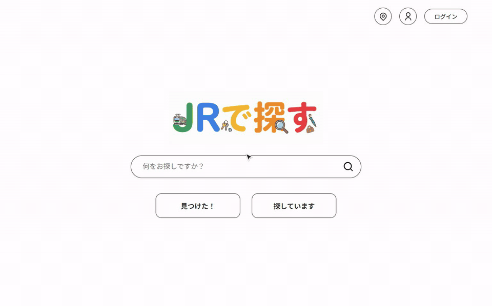
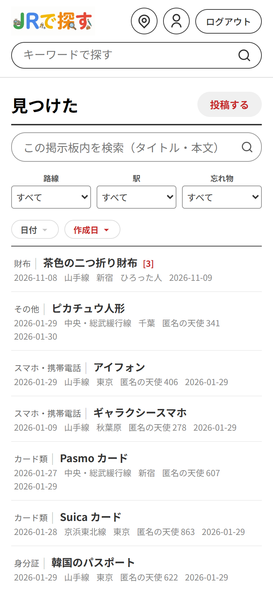
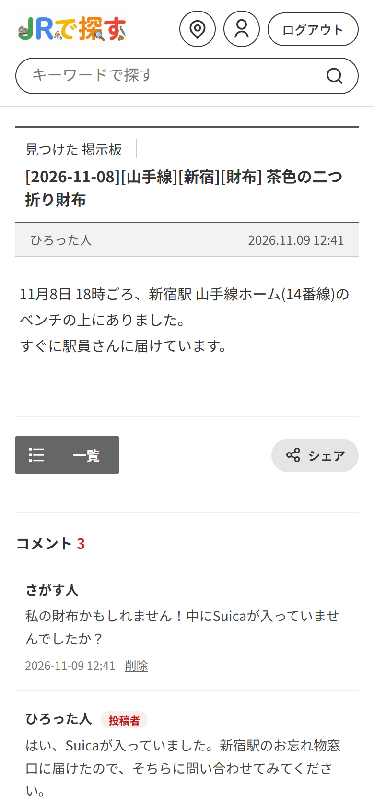
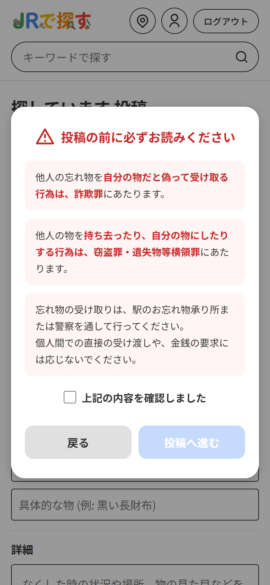

# JR Find

[한국어](README.md) | **日本語**

ドキュメント: [API 仕様](docs/API.ja.md) · [システム構成・DB 設計](docs/ARCHITECTURE.ja.md)

東京のJR駅の忘れ物掲示板 Web アプリケーションです。（画面の言語：日本語）

- **見つけた** 掲示板：拾った物を知らせる掲示板。ログインしなくても投稿でき（投稿時に決めた4桁のパスワードで編集・削除）、会員はログイン中のアカウントで投稿し、パスワードなしで編集・削除できます。
- **探しています** 掲示板：なくした物を探す掲示板。会員のみ投稿できます。
- どちらの掲示板でも、会員はコメントを書けます。（お礼や「お忘れ物承り所に届けました」などの続報）

## 概要

| | |
|---|---|
| 期間 | 企業の短期インターンシップ 2026.01.05〜01.30（4週間）→ 改善開発 2026.02〜11 |
| 人数 | 1名（個人開発） |
| 担当 | 企画、設計（基本設計書・画面遷移図）、実装、テスト（単体テスト仕様書）、発表 |
| 範囲 | 設計した19画面のうちインターン中に7画面を実装し、改善開発で19画面すべてを実装 |
| AI活用 | インターンでは実装でAIの助けも借り、コードを理解してから記述。改善開発はClaude Codeと実装し、変更ごとに自分で確認・修正 |
| このリポジトリ | 改善開発を終えたコードを2026年11月に整理して公開したもの（インターン当時のコードと設計書は含まない） |



まず見てほしいところ

- 検索：保存時にNFKC・小文字へ整えた検索用の列だけを比較 → [KeywordCondition.java](src/main/java/com/example/jrfind/repository/KeywordCondition.java)、[パフォーマンス](#パフォーマンス)
- 削除・権限：存在しない投稿・削除済みの投稿は404、権限のない編集・削除は403 → [JrfindController.java](src/main/java/com/example/jrfind/controller/JrfindController.java)、同時の編集・削除に備えた条件付きUPDATE → [JdbcJrfindRepository.java](src/main/java/com/example/jrfind/repository/JdbcJrfindRepository.java)
- 試行回数の制限：4桁のパスワードとログインは5回間違えると5分ロック（IDを変えても同じIPから20回でそのIPをロック） → [PasswordAttemptLimiter.java](src/main/java/com/example/jrfind/service/PasswordAttemptLimiter.java)、[LoginAttemptGuard.java](src/main/java/com/example/jrfind/config/LoginAttemptGuard.java)
- テスト：画面を通さない直接のリクエストまでMockMvcで確認 → [JrfindControllerTest.java](src/test/java/com/example/jrfind/controller/JrfindControllerTest.java)

## 画面

<table>
  <tr>
    <td width="50%"><br>ホーム — 統合検索ボックスと両掲示板への入口</td>
    <td width="50%"><br>見つけた 一覧 — 掲示板内検索、路線・駅・カテゴリでの絞り込み、並べ替え、コメント数</td>
  </tr>
  <tr>
    <td><br>見つけた 詳細 — コメント（投稿者本人には「投稿者」を表示）、お忘れ物の問い合わせ先</td>
    <td><br>探しています 一覧 — 見つかった物には「見つかりました」を表示</td>
  </tr>
  <tr>
    <td><br>探しています 投稿前の注意事項 — 詐欺・窃盗に関する警告を確認してから投稿</td>
    <td><br>統合検索 — 両掲示板から最新5件ずつ</td>
  </tr>
  <tr>
    <td><br>駅マップ — 路線図と駅ごとの投稿数、お忘れ物の問い合わせ先</td>
    <td><br>マイページ — 自分の会員情報と投稿・コメント</td>
  </tr>
</table>

スマートフォン表示（幅390px）

<table>
  <tr>
    <td width="33%"><br>一覧 — 表をカード形式に</td>
    <td width="33%"><br>詳細</td>
    <td width="33%"><br>探しています 投稿前の注意事項</td>
  </tr>
</table>

スクリーンショットの投稿・会員情報はすべてテスト用のデータです。

## 技術スタック

- Java 21, Spring Boot 4.0（Spring MVC, Spring Security, JDBC, Validation）
- Thymeleaf, HTML / CSS / JavaScript, flatpickr, Leaflet + OpenStreetMap（駅マップ）
  - flatpickr・Leaflet は WebJars で jar に含めてアプリから直接配信（外部 CDN がブロックされても動作、バージョンは `pom.xml` で管理）
- H2 Database（ファイルモード）
- Maven

## 実行方法

Java 21 が必要です。

```bash
./mvnw spring-boot:run        # Windows: mvnw.cmd spring-boot:run
```

ブラウザで http://localhost:8080 にアクセスします。

- 初回起動時に `data/` フォルダに H2 DB が作成され、`schema.sql`・`data.sql` によってテーブルと路線・駅・カテゴリのデータが登録されます。
- アップロードした画像は `uploads/` フォルダに保存されます。
- H2 コンソールはデフォルトでは無効です。環境変数 `JRFIND_H2_CONSOLE=true` で有効にすると http://localhost:8080/h2-console で確認できます（このPCからのみ接続可能。JDBC URL `jdbc:h2:file:./data/jrfinddb`、ユーザー `sa`、パスワードなし）

設定は環境変数で変更できます。

| 環境変数 | デフォルト値 | 説明 |
|---|---|---|
| `SPRING_DATASOURCE_URL` | `jdbc:h2:file:./data/jrfinddb;AUTO_SERVER=TRUE` | DB 接続 URL |
| `SPRING_DATASOURCE_USERNAME` / `SPRING_DATASOURCE_PASSWORD` | `sa` /（なし） | DB アカウント |
| `JRFIND_UPLOAD_DIR` | `./uploads` | 画像の保存フォルダ |
| `JRFIND_H2_CONSOLE` | `false` | H2 コンソールの使用（開発用） |

テスト：`./mvnw test`（インメモリ DB を使用）

## 主な機能（「見つけた」掲示板）

- 投稿一覧：路線・駅・カテゴリでの絞り込み、発見日・投稿日での並べ替え、ページネーション（15件ずつ）
  - 投稿・並べ替え・ページ番号はサーバーが生成するリンク、絞り込みはフォームのため、キーボード（Tab・Enter）・新しいタブ・JS 無効のブラウザでも動作
  - 絞り込みはマウスで選ぶとすぐに適用し、キーボードで選ぶときは「絞り込む」で適用（↑↓ で値を変えている途中で画面が切り替わらないように）
  - ページ番号は最初・最後と現在のページの前後2ページのみ。詳細画面の「一覧」は見ていた一覧（絞り込み・並べ替え・ページ）に戻る
- 投稿登録：カレンダーで発見日を選択、路線に応じて駅の選択肢が切り替わる、タイトルの自動生成、写真の添付
- 非会員の投稿：投稿者名を自動で付与（`匿名の天使 001` 形式、使われていない番号から。1,000個すべて使われている場合は任意の番号）、4桁のパスワードを確認してから編集・削除
  - 保存すると確認が解除されるため、別のタブで先に保存した場合や、保存後に「戻る」で戻って再送信した場合は、入力内容を保管したうえでパスワードを再確認し、編集画面に戻す
- 会員の投稿：ニックネームで表示、投稿者本人のみ編集・削除可能（削除はすべて論理削除）

## 探しています 掲示板

- 一覧・詳細は誰でも閲覧でき、投稿・編集・削除は会員のみ（未ログインの場合は案内メッセージとともにログイン画面へ移動し、ログイン後は元の画面に戻る）
- 投稿前に注意事項（詐欺・窃盗に関する警告）を確認しないと投稿できない（サーバー側でも確認の有無をチェック）
- なくした駅がわからない場合は「駅がわからない」を選択可能（タイトルには `駅不明` と表示）
- 投稿者は物が見つかったら「見つかりました」と表示できる（一覧・詳細に表示、解除も可能）
- 一覧の絞り込み・並べ替え・ページネーション、写真の添付は「見つけた」掲示板と同じ
- 入力エラーで画面が再表示されても入力内容を保持

## コメント（両掲示板共通）

- コメントは誰でも閲覧でき、投稿は会員のみ（未ログインの場合は「ログイン」リンク → ログイン後にその投稿のコメント位置に戻る）
- コメントを書いた本人のみ削除可能（論理削除）。投稿者本人が書いたコメントには「投稿者」と表示
- 最大500文字。空のコメントは画面とサーバーの両方で防ぎ、エラー時も入力内容を保持
- 一覧画面で、物の名前の横にコメント数を表示
- コメントが多い投稿は最新50件だけを表示し、その上の「以前のコメント(N件)をすべて表示」ですべて表示（マイページの自分のコメントのリンクはすべて表示する URL）
- 1つのコメントテーブルを両掲示板で共用（`FOUNDITEMID` / `LOSTITEMID` のどちらか一方だけに値が入るよう CHECK 制約）

## 検索

- ヘッダー・ホーム画面の検索ボックス → 統合検索画面（`/search?q=`）：両掲示板の最新5件ずつと総件数、「すべて見る」で各掲示板の一覧へ移動
- 各掲示板の一覧上部の検索ボックス → その掲示板内だけを検索（選択中の絞り込み・並べ替えはそのまま、1ページ目から表示）。空欄で検索するとキーワードだけを解除
- 掲示板の一覧では、検索キーワード（`?q=`）と路線・駅・カテゴリの絞り込み、並べ替え、ページ移動を組み合わせて使用可能（「検索をやめる」でキーワードだけを解除）
- タイトル（日付・路線・駅・カテゴリ・物の名前を含む）と本文から検索。空白（全角を含む）で区切った単語をすべて含む投稿のみ表示（最大5単語。超えた場合は画面で案内）
- 大文字・小文字は区別しない。`%` `_` はワイルドカードではなく文字そのものとして検索（LIKE のエスケープ）
- 全角・半角も区別しない（ｽﾏﾎ ↔ スマホ、Ｓｕｉｃａ ↔ suica、（予定） ↔ (予定)）：投稿を保存するときにタイトル＋本文を NFKC・小文字に統一した検索用カラム（`SEARCHTEXT`）を
  一緒に保存し、キーワードも同じ方法で統一してそのカラムだけを比較（検索のたびに全投稿を変換しない）。このカラムがなかった DB の投稿はサーバー起動時に埋める

## 会員登録・ログイン

- 会員登録：ID、パスワード、氏名、ニックネーム（任意、空欄の場合は氏名）、生年月日、電話番号、個人情報の取り扱いへの同意
- 入力エラーは項目ごとに表示し、入力内容は保持（ID の重複、確認用パスワードの不一致を含む）
- ID は大文字・小文字を区別せず1つだけ（登録画面で確認し、同時に登録した場合は DB のユニークインデックスで防ぐ）
- ログイン・ログアウトは Spring Security のフォームログインを使用。ログインに失敗した場合、ID とパスワードのどちらが間違っているかは区別しない
- 連続で失敗すると一時的にログインを制限し、案内メッセージを表示（基準は下記「セキュリティ対策」）。ロックまで残り3回以下になると残り回数を事前に案内

## マイページ（`/mypage`、会員のみ）

- ヘッダーのユーザーアイコン・ニックネームから移動。自分の会員情報と、自分の投稿（見つけた / 探しています）・コメントをタブごとに10件ずつ表示
- コメントタブで行を押すと、その投稿の該当コメントの位置へ移動（削除された投稿のコメントは除外）
- 会員情報の変更（氏名・ニックネーム・生年月日・電話番号、ID は変更不可）：ニックネームを変更すると、これまでの投稿・コメントの投稿者名もまとめて変更（トランザクション）。再ログインしなくてもヘッダーにすぐ反映
- パスワードの変更：現在のパスワードを確認（5回連続で失敗すると5分間ロック）、新しいパスワードのルール・確認用との一致をチェック
- 退会（`/mypage/withdraw`）：パスワードの再確認 + 注意事項の確認チェック + 確認ダイアログ
  - 会員情報（ID・パスワード・氏名・生年月日・電話番号）は削除し、投稿・コメントは残して投稿者名を「退会したユーザー」に変更（トランザクション）
  - 退会画面に、残っている自分の投稿・コメントの件数を表示し、消したい投稿は退会前に削除できるようにした
  - 他のブラウザ・端末でログイン中のセッションもまとめて終了（Spring Security の `SessionRegistry`）
  - 同じ ID で再登録できるが、以前の投稿・コメントとは紐づかない（投稿・コメントは会員番号で紐づけ）
  - 「退会したユーザー」はニックネームとして使用不可（「匿名の天使」で始まる名前と同じ扱い。空白・見えない文字を入れても、半角カナで書いても同じ）
  - DB でも CHECK 制約で「退会していない会員は個人情報がすべて揃っていて、退会した会員はすべて空」であることを保証

## 駅マップ（`/map`）

- ヘッダー・ホーム画面の地図アイコンから移動。Leaflet + OpenStreetMap の地図（API キー不要）
- 駅ごとにマーカーを表示（投稿がある駅は赤色）。駅を押すと、通る路線と 見つけた / 探しています の投稿数、その駅で絞り込んだ掲示板一覧へのリンクを表示
- 路線図：路線ごとの色で駅を順番につないだ線（凡例のチェックボックスで路線ごとに表示・非表示）、「全体を表示」で全路線の範囲を表示
- 駅の位置は `STATION_LOCATION` テーブル（`data.sql`、HeartRails Express API で取得した座標）、地図データは `/map/stations`（JSON）
- お忘れ物の問い合わせ先の案内（JR東日本 お忘れ物問い合わせの電話番号・受付時間、東京駅・大宮駅 お忘れ物承り所）：地図と両詳細画面のサイドバーに共通で表示。JR東日本 公式サイトの情報に基づき、変更される場合がある旨の案内と公式ページへのリンクも掲載

## スマートフォン表示

- すべての画面に viewport を指定し、共通スタイル `static/css/mobile.css`（幅768px以下でのみ適用）でスマートフォン向けに配置
- タブレット幅（769〜1024px）：一覧はサイドバーを下に移して表を広く（日付・投稿日が切れないように）、ヘッダーの検索ボックスは残りの幅に合わせる
- ヘッダーはロゴとアイコンを1行に、検索ボックスは下の行いっぱいに。本文とサイドバーは縦に並べる（掲示板の一覧ではタイトルの横に「投稿する」）
- 一覧の表はカード形式（物の名前を1行目に）、登録・会員フォームは項目名を入力欄の上に、ダイアログは画面幅に合わせる
- PC 画面のレイアウトはそのまま

## アクセシビリティ

- すべての入力欄に名前（`label` または `aria-label`）を付け、形式の案内・エラーメッセージは `aria-describedby` でその欄に関連付け。サーバー側の検証でエラーになった場合は最初のエラー欄にフォーカス
- 確認ダイアログ（モーダル）は `role="dialog"`。開くとダイアログ内にフォーカスを移し、Tab はダイアログ内のみ、Esc で閉じ、閉じると元の位置へ（js/dialog.js）
- 詳細画面の編集・削除ボタンはリンク（`?verify=edit`、`?confirmDelete`）：JS があれば画面内でダイアログを開き、なければサーバーがダイアログを開いた画面を返す。
  非会員の投稿のパスワード確認もフォームのため JS なしで確認可能（`POST /items/{id}/verify`）。Enter で確認、4桁の数字でなければ失敗回数に数えない（全角数字は半角に）
- 写真の添付は非表示のファイル欄 + `label` のため、キーボード（Tab → Enter）でも選択可能。入力欄・ボタンにフォーカス表示
- JS を無効にしても投稿の閲覧・登録が可能：一覧はリンクと GET フォーム、駅は最初から選択でき、サーバー側の検証メッセージは画面にそのまま表示。
  探しています の投稿前の注意事項は、JS があれば最初にダイアログで、なければフォームの上に表示（チェック欄がそのまま確認の値）
- 入力中にほかの画面へ移動しようとすると確認（画面内のリンクはこの画面のダイアログ、戻る・再読み込み・タブを閉じる場合はブラウザの確認）。入力がなければ確認しない
- 入力エラーで再表示した画面（POST の応答）で再読み込み・戻るを行っても、フォームを再送信しない：履歴をアドレスバーの URL に置き換える（`history.replaceState`、JS 無効時はブラウザの標準動作）
- 画面ごとに見出しは h1 を1つ、ヘッダーの前に「本文へ移動」（最初の Tab）、アイコンだけのリンク・ボタンに名前、装飾用の SVG は読み上げない（`aria-hidden`）
- 駅マップ：地図の横の「駅を選ぶ」で、キーボード・スクリーンリーダーでも駅を選択可能（駅マーカー47個は Tab 順から除外）。地図を読み込めない場合や JS が無効の場合は案内し、駅の選択は掲示板の一覧へ移動するフォームとして動作
- 文字色は背景とのコントラスト比 4.5:1 以上、共通スタイルの文字サイズは rem（ブラウザの文字サイズ設定に従う）、ハイコントラストモードでダイアログ・ボタンの枠を表示

## セキュリティ対策

- パスワード（会員・非会員の投稿とも）は BCrypt ハッシュで保存し、画面（HTML）には出力しない
- コンテンツセキュリティポリシー（CSP）：スクリプトはこのサイトのファイルのみ（`script-src 'self'`）。画面にインラインスクリプト・`on…` 属性がないため、
  投稿などにスクリプトが紛れ込んでも実行されない（テストで全画面を検査）。他サイトの iframe には埋め込めない（`frame-ancestors 'none'`）
- すべての POST リクエストで CSRF トークンを確認（フォームは hidden 項目、fetch はヘッダーで送信）
  - ログインせずに投稿を見るだけのときはトークンを作らないため、セッションも作られない（訪問者・検索ロボットごとにセッションがたまらないように）。
    非会員の投稿のパスワード確認は、送信直前に `GET /csrf` でトークンを受け取る
  - 画面を長時間開いていてトークンが一致しない場合は、403 ではなく元の画面に戻して案内。登録・編集・コメントは入力内容を保管し、
    同じフォームを再度開いたときに戻す（ログインが切れていれば再ログイン後、非会員の投稿はパスワード再確認後）。保管は1セッションに1件、2,000文字まで
- 編集・削除の権限はサーバーで確認：会員の投稿は投稿者本人、非会員の投稿は「パスワード確認を通過したセッション」、コメントは書いた本人（画面の JS チェックだけに頼らない）
- パスワードを5回連続で間違えると5分間ロック（4桁パスワードの総当たり攻撃対策）。残り3回以下になると残り回数を、ロックされるとロック時間を案内
  - 存在しない投稿・削除された投稿・会員の投稿への確認は 404 を返し、失敗回数に数えない（別のタブで削除した投稿に正しいパスワードを入力してもロックされない）
- ログインの連続失敗制限（ロック中は正しいパスワードでも確認しない）
  - 同じ接続元 IP から同じ ID で5回失敗すると、その IP からその ID へのログインを5分間ブロック
  - ID を変えながら失敗しても、同じ IP から20回に達するとその IP からのログインを5分間ブロック（自分のアカウントにログインしてもこの回数はリセットされない）
  - ID だけでロックせず接続元 IP と組み合わせて数えるため、他人がわざと間違えても、別の場所にいる本人はログインし続けられる
  - 存在しない ID も同じように数えて同じようにロックするため、ロックの有無から ID が存在するかどうかはわからない
- アップロードファイルは先頭のバイト列（マジックナンバー）で実際に画像かどうかを確認し、元のファイル名ではなくサーバーで生成した名前で保存（パストラバーサル対策）
- JPG の写真は保存し直して撮影情報（EXIF：撮影場所の GPS・機種など）を削除。スマートフォンで撮った写真の回転情報は、削除する前に画素に反映
- 解像度が5,000万画素を超える画像は、サイズだけを読んで受け付けない（ファイルは小さくても、展開するとサーバーのメモリを使い切ってしまう画像への対策）
- 写真を差し替え・削除すると以前の画像ファイルを、投稿を削除するとその投稿の画像ファイルをアップロードフォルダから削除
  （削除した投稿の写真が `/images/ファイル名` で表示され続けないように。DB への反映後に削除し、アップロードフォルダ外のファイルは削除しない）。
  保存の途中でサーバーが止まった場合などに残ったファイルは、毎日午前4時に整理（どの投稿も使っておらず、1時間以上たったファイル）
- 同じ投稿を同時に編集・削除しても片方だけ反映：編集・削除は「削除されておらず、写真が読み込んだときのまま」の場合のみ反映する条件付き UPDATE。
  遅れた側の編集は案内してやり直してもらい、新しく保存した写真は削除（削除した投稿に写真が公開されたまま残ったり、使われないファイルがたまったりしないように）
- コメントは投稿が削除されていない場合のみ登録（確認と保存を INSERT … SELECT の1文で）
- 入力値はサーバーでも再検証（Bean Validation + 路線・駅・カテゴリが実在するか）
  - 検証の前に整える：改行は LF に、前後の空白（全角・NBSP）とゼロ幅文字は削除し、文字の向きを変える制御文字（U+202E など）はどこにあっても削除
    （見えない文字だけの品名が登録されたり、一覧で文字が逆向きに表示されたりする問題）
- 同じ利用者が同じ場所に同じ内容を10分以内に再送信した場合は1回だけ保存（投稿登録・コメント。登録後に「戻る」で戻って再送信した場合やボタンの連打）
- セッションクッキーは `HttpOnly`、`SameSite=Lax`、URL にセッション ID を含めない

## パフォーマンス

投稿1万件（見つけた 10,000・探しています 3,400）と、コメントが300件付いた投稿がある DB で、改善前後のサーバーに同じ PC から交互にリクエストして比較した値（中央値、3回測定）。
投稿・コメントが書き込まれ続ける掲示板と同じ条件になるよう、H2 が同じ検索結果を再利用しないようにした。絶対値は PC の状態によって変わるため、倍率で見るのが正確です。

| 画面 | 改善前 | 改善後 | |
|---|---:|---:|---:|
| 掲示板内の検索（`/items?q=財布`） | 271 ms | 36 ms | 7.6倍 |
| 掲示板内の検索（半角カナ `ｽｲｶ`） | 497 ms | 36 ms | 14倍 |
| 統合検索（全角5単語） | 984 ms | 43 ms | 23倍 |
| 統合検索（最も遅いケース：`ｰ` 5単語） | 2,891 ms | 38 ms | 76倍 |
| 見つけた 一覧1ページ目 | 63 ms | 33 ms | 1.9倍 |
| コメント300件の投稿の詳細（HTML） | 274 KB | 66 KB | |
| 一覧の初回表示の転送量（HTML・CSS・JS・ロゴ） | 316 KB | 26 KB | |
| 同じ画面の2回目の表示 | CSS・JS・ロゴを再取得 | HTML のみ | |
| スマートフォンの写真（4032×3024、9.4MB）をアップロードした後、詳細で受け取るサイズ | 9.4 MB | 273 KB | |

- 検索：検索用カラム（`SEARCHTEXT`）だけを比較。以前は検索のたびに全投稿のタイトル・本文を `LOWER(TRANSLATE(…))` で変換し、単語ごとに条件が2〜4個あった
- 一覧：登録日・発見日 + ID のインデックスで1ページ分だけを読む（以前は全投稿のコメント数を数えてから並べ替え）。路線・駅・カテゴリは最初に一度だけ読む
- 静的ファイル：レスポンス圧縮（gzip）、CSS・JS・ロゴは URL にファイル内容のハッシュを付け（`mobile-<ハッシュ>.css`）1年間キャッシュ。ロゴは表示サイズに合わせたファイル（265KB → 10KB）
- 写真：長辺 1,280px に縮小して保存（アップロード処理は1,200万画素の写真で約0.9秒増える）
- 詳細画面：最新のコメント50件のみ

## フォルダ構成

```
src/main/java/com/example/jrfind
├─ JrFindApplication.java
├─ config/       SecurityConfig（ログイン・CSRF）、LoginAttemptGuard（ログインの連続失敗制限）、
│                ExpiredFormHandler（長時間開いたフォームを送信したときの案内）、WebMvcConfig（アップロード画像・ロゴのパス・キャッシュ）、
│                CacheConfig（路線・駅・カテゴリをメモリに）
├─ controller/   JrfindController（見つけた）、LostItemController（探しています）、CommentController（コメント）、
│                SearchController（統合検索）、MemberController、MyPageController（マイページ）、
│                MapController（駅マップ）、LoginMemberAdvice（ヘッダー用のログイン情報）、
│                BoardQuery（一覧の条件を保持したリンクの URL）、
│                VerifiedItems（パスワード確認状態・セッション）、FormDraft（送信できなかった入力の保管・セッション）、
│                SubmittedForms（同じ内容の二重登録の防止・セッション）、CsrfController（JS が送信直前に受け取る CSRF トークン）
├─ domain/       FoundItem, FoundItemForm, LostItem, LostItemForm, Comment, CommentForm, Board,
│                Member, SignupForm, ProfileForm, PasswordForm, WithdrawForm, LoginMember, Category, Station,
│                StationLocation, MapData, Texts（入力文字列の整理）
├─ repository/   JrfindRepository, LostItemRepository, CommentRepository, MemberRepository（+ JdbcTemplate による実装）、
│                KeywordCondition（検索キーワードの SQL 条件・検索用の値）、SearchTextBackfill（空の検索用カラムを埋める）
└─ service/      JrfindService, LostItemService, CommentService, MemberService, MapService,
                 ImageStorage, ImageResizer（写真の縮小・撮影情報の削除）、OrphanImageCleaner（使われない写真の整理）,
                 PasswordAttemptLimiter
src/main/resources
├─ schema.sql, data.sql, messages.properties（入力形式エラーの文言）
├─ static/       css/mobile.css（スマートフォン表示）、css/board-list.css・js/board-list.js（両掲示板の一覧で共通）、
│                css/post-detail.css・js/post-detail.js（詳細画面で共通）、
│                css/post-form.css・js/post-form.js（登録・編集画面で共通）、js/dialog.js（確認ダイアログ）、
│                js/member-form.js（会員画面）、js/comments.js（コメント）、js/js-enabled.js、
│                js/submit-once.js（二重送信の防止）、
│                js/page-restore.js（「戻る」で表示された画面の処理）、
│                js/date-input.js（日付の直接入力の確認）、js/share-link.js（「シェア」）
├─ templates/    home, ItemList, itemDetail, registerForm, editForm（見つけた）
│                lostList, lostDetail, lostForm（探しています）, search, login, signup,
│                mypage, profileEdit, passwordChange, withdraw（マイページ）, map（駅マップ）, error,
│                fragments/header, fragments/comments（両詳細画面で共通のコメント欄）,
│                fragments/lostCenter（お忘れ物の問い合わせ先）
└─ logo/
```

## 今後の改善点

- ID・パスワードを忘れた場合の照会・再設定（会員情報にメールアドレスがないため、まず本人確認の手段を用意する必要がある）
- 企画段階の発展機能：1対1チャット、駅周辺の位置選択、写真の複数枚添付
