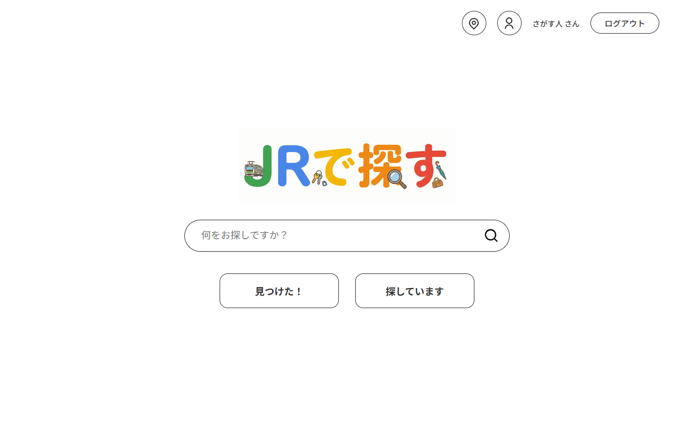
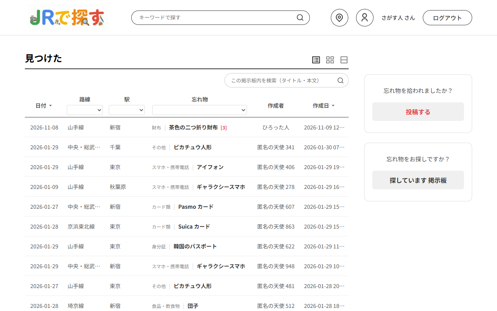
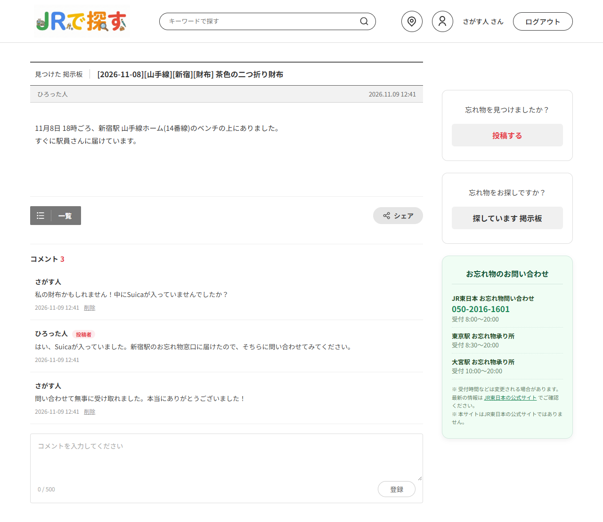
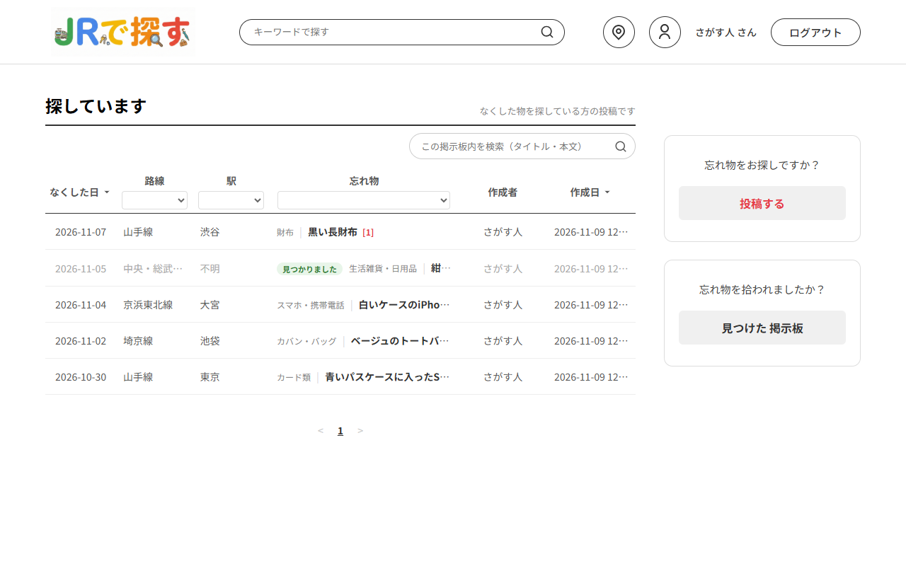
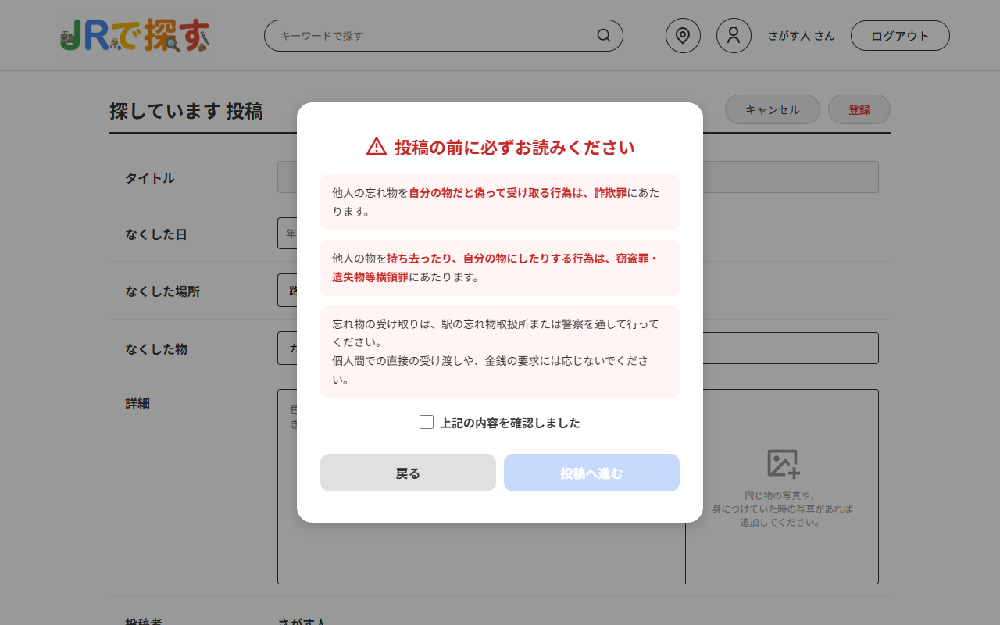
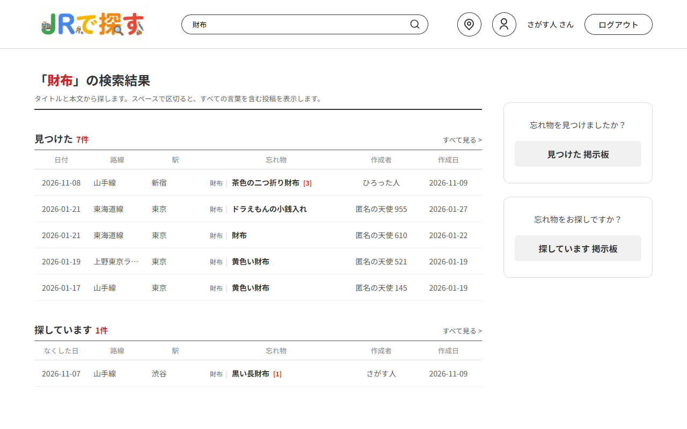
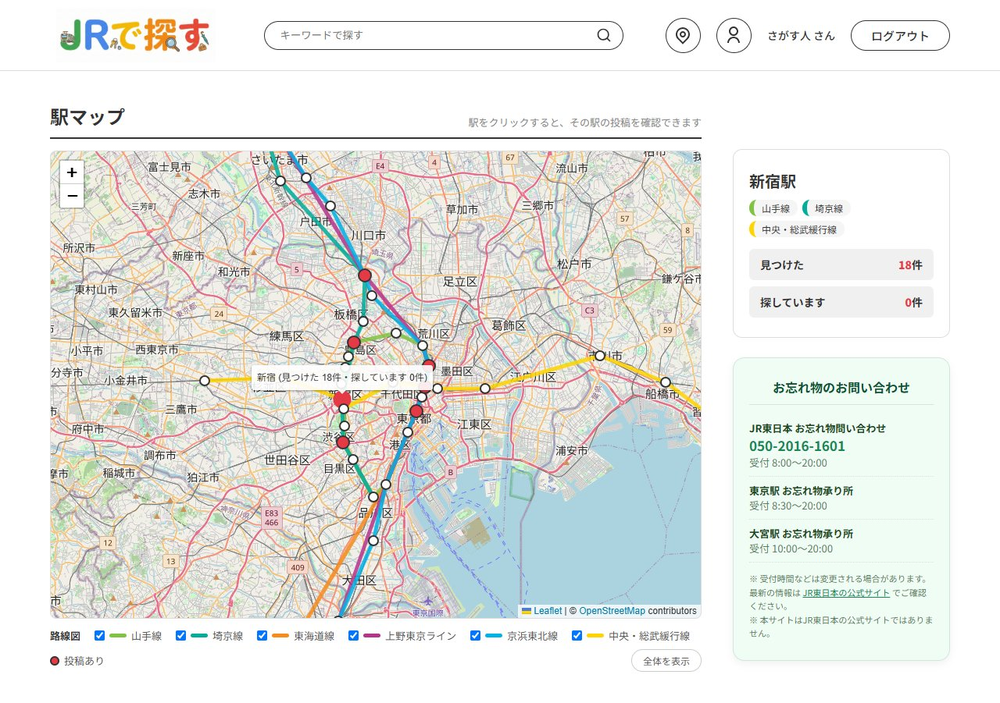
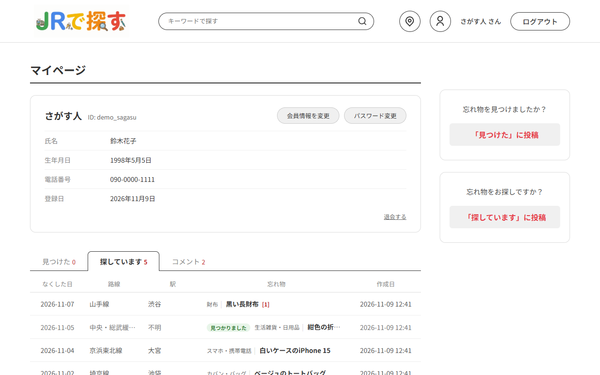

# JR Find

[한국어](README.md) | **日本語**

東京の JR 駅の忘れ物掲示板 Web アプリケーションです。（画面の言語：日本語）

- **見つけた** 掲示板：拾った物を知らせる掲示板。ログインしなくても投稿でき（投稿時に決めた4桁のパスワードで編集・削除）、会員はログイン中のアカウントで投稿し、パスワードなしで編集・削除できます。
- **探しています** 掲示板：なくした物を探す掲示板。会員のみ投稿できます。
- どちらの掲示板でも、会員はコメントを書けます。（お礼や「お忘れ物承り所に届けました」などの続報）

## 画面

<table>
  <tr>
    <td width="50%"><br>ホーム — 統合検索ボックスと両掲示板への入口</td>
    <td width="50%"><br>見つけた 一覧 — 掲示板内検索、路線・駅・カテゴリでの絞り込み、並べ替え、コメント数</td>
  </tr>
  <tr>
    <td><br>見つけた 詳細 — コメント（投稿者本人には「投稿者」を表示）、お忘れ物の問い合わせ先</td>
    <td><br>探しています 一覧 — 見つかった物には「見つかりました」を表示</td>
  </tr>
  <tr>
    <td><br>探しています 投稿前の注意事項 — 詐欺・窃盗に関する警告を確認してから投稿</td>
    <td><br>統合検索 — 両掲示板から最新5件ずつ</td>
  </tr>
  <tr>
    <td><br>駅マップ — 路線図と駅ごとの投稿数、お忘れ物の問い合わせ先</td>
    <td><br>マイページ — 自分の会員情報と投稿・コメント</td>
  </tr>
</table>

スクリーンショットの投稿・会員情報はすべてテスト用のデータです。

## 技術スタック

- Java 21, Spring Boot 4.0（Spring MVC, Spring Security, JDBC, Validation）
- Thymeleaf, HTML / CSS / JavaScript, flatpickr, Leaflet + OpenStreetMap（駅マップ）
- H2 Database（ファイルモード）
- Maven

## 実行方法

Java 21 が必要です。

```bash
./mvnw spring-boot:run        # Windows: mvnw.cmd spring-boot:run
```

ブラウザで http://localhost:8080 にアクセスします。

- 初回起動時に `data/` フォルダに H2 DB が作成され、`schema.sql`・`data.sql` によってテーブルと路線・駅・カテゴリのデータが登録されます。
- アップロードした画像は `uploads/` フォルダに保存されます。
- H2 コンソール：http://localhost:8080/h2-console（JDBC URL `jdbc:h2:file:./data/jrfinddb`、ユーザー `sa`、パスワードなし）

設定は環境変数で変更できます。

| 環境変数 | デフォルト値 | 説明 |
|---|---|---|
| `SPRING_DATASOURCE_URL` | `jdbc:h2:file:./data/jrfinddb;AUTO_SERVER=TRUE` | DB 接続 URL |
| `SPRING_DATASOURCE_USERNAME` / `SPRING_DATASOURCE_PASSWORD` | `sa` /（なし） | DB アカウント |
| `JRFIND_UPLOAD_DIR` | `./uploads` | 画像の保存フォルダ |

テスト：`./mvnw test`（インメモリ DB を使用）

## 主な機能（見つけた 掲示板）

- 投稿一覧：路線・駅・カテゴリでの絞り込み、発見日・投稿日での並べ替え、ページネーション（15件ずつ）
- 投稿登録：カレンダーで発見日を選択、路線に応じて駅の選択肢が切り替わる、タイトルの自動生成、写真の添付
- 非会員の投稿：投稿者名を自動で付与（`匿名の天使 001` 形式）、4桁のパスワードを確認してから編集・削除
- 会員の投稿：ニックネームで表示、投稿者本人のみ編集・削除可能（削除はすべて論理削除）

## 探しています 掲示板

- 一覧・詳細は誰でも閲覧でき、投稿・編集・削除は会員のみ（未ログインの場合は案内メッセージとともにログイン画面へ移動し、ログイン後は元の画面に戻る）
- 投稿前に注意事項（詐欺・窃盗に関する警告）を確認しないと投稿できない（サーバー側でも確認の有無をチェック）
- なくした駅がわからない場合は「駅がわからない」を選択可能（タイトルには `駅不明` と表示）
- 投稿者は物が見つかったら「見つかりました」と表示できる（一覧・詳細に表示、解除も可能）
- 一覧の絞り込み・並べ替え・ページネーション、写真の添付は 見つけた 掲示板と同じ
- 入力エラーで画面が再表示されても入力内容を保持

## コメント（両掲示板共通）

- コメントは誰でも閲覧でき、投稿は会員のみ（未ログインの場合は「ログイン」リンク → ログイン後にその投稿のコメント位置に戻る）
- コメントを書いた本人のみ削除可能（論理削除）。投稿者本人が書いたコメントには「投稿者」と表示
- 最大500文字。空のコメントは画面とサーバーの両方で防ぎ、エラー時も入力内容を保持
- 一覧画面で、物の名前の横にコメント数を表示
- 1つのコメントテーブルを両掲示板で共用（`FOUNDITEMID` / `LOSTITEMID` のどちらか一方だけに値が入るよう CHECK 制約）

## 検索

- ヘッダー・ホーム画面の検索ボックス → 統合検索画面（`/search?q=`）：両掲示板の最新5件ずつと総件数、「すべて見る」で各掲示板の一覧へ移動
- 各掲示板の一覧上部の検索ボックス → その掲示板内だけを検索（選択中の絞り込み・並べ替えはそのまま、1ページ目から表示）。空欄で検索するとキーワードだけを解除
- 掲示板の一覧では、検索キーワード（`?q=`）と路線・駅・カテゴリの絞り込み、並べ替え、ページ移動を組み合わせて使用可能（「検索をやめる」でキーワードだけを解除）
- タイトル（日付・路線・駅・カテゴリ・物の名前を含む）と本文から検索。空白（全角を含む）で区切った単語をすべて含む投稿のみ表示（最大5単語）
- 大文字・小文字は区別しない。`%` `_` はワイルドカードではなく文字そのものとして検索（LIKE のエスケープ）

## 会員登録・ログイン

- 会員登録：ID、パスワード、氏名、ニックネーム（任意、空欄の場合は氏名）、生年月日、電話番号、個人情報の取り扱いへの同意
- 入力エラーは項目ごとに表示し、入力内容は保持（ID の重複、確認用パスワードの不一致を含む）
- ログイン・ログアウトは Spring Security のフォームログインを使用。ログインに失敗した場合、ID とパスワードのどちらが間違っているかは区別しない
- 連続で失敗すると一時的にログインを制限し、案内メッセージを表示（基準は下記「セキュリティ対策」）

## マイページ（`/mypage`、会員のみ）

- ヘッダーのユーザーアイコン・ニックネームから移動。自分の会員情報と、自分の投稿（見つけた / 探しています）・コメントをタブごとに10件ずつ表示
- コメントタブで行を押すと、その投稿の該当コメントの位置へ移動（削除された投稿のコメントは除外）
- 会員情報の変更（氏名・ニックネーム・生年月日・電話番号、ID は変更不可）：ニックネームを変更すると、これまでの投稿・コメントの投稿者名もまとめて変更（トランザクション）。再ログインしなくてもヘッダーにすぐ反映
- パスワードの変更：現在のパスワードを確認（5回連続で失敗すると5分間ロック）、新しいパスワードのルール・確認用との一致をチェック
- 退会（`/mypage/withdraw`）：パスワードの再確認 + 注意事項の確認チェック + 確認ダイアログ
  - 会員情報（ID・パスワード・氏名・生年月日・電話番号）は削除し、投稿・コメントは残して投稿者名を「退会したユーザー」に変更（トランザクション）
  - 退会画面に、残っている自分の投稿・コメントの件数を表示し、消したい投稿は退会前に削除できるようにした
  - 他のブラウザ・端末でログイン中のセッションもまとめて終了（Spring Security の `SessionRegistry`）
  - 同じ ID で再登録できるが、以前の投稿・コメントとは紐づかない（投稿・コメントは会員番号で紐づけ）
  - 「退会したユーザー」はニックネームとして使用不可（「匿名の天使」で始まる名前と同じ扱い）
  - DB でも CHECK 制約で「退会していない会員は個人情報がすべて揃っていて、退会した会員はすべて空」であることを保証

## 駅マップ（`/map`）

- ヘッダー・ホーム画面の地図アイコンから移動。Leaflet + OpenStreetMap の地図（API キー不要）
- 駅ごとにマーカーを表示（投稿がある駅は赤色）。駅を押すと、通る路線と 見つけた / 探しています の投稿数、その駅で絞り込んだ掲示板一覧へのリンクを表示
- 路線図：路線ごとの色で駅を順番につないだ線（凡例のチェックボックスで路線ごとに表示・非表示）、「全体を表示」で全路線の範囲を表示
- 駅の位置は `STATION_LOCATION` テーブル（`data.sql`、HeartRails Express API で取得した座標）、地図データは `/map/stations`（JSON）
- お忘れ物の問い合わせ先の案内（JR東日本 お忘れ物問い合わせの電話番号・受付時間、東京駅・大宮駅 お忘れ物承り所）：地図と両詳細画面のサイドバーに共通で表示。2026年11月時点の JR東日本 公式サイトの情報に基づき、公式ページへのリンクも掲載

## セキュリティ対策

- パスワード（会員・非会員の投稿とも）は BCrypt ハッシュで保存し、画面（HTML）には出力しない
- すべての POST リクエストで CSRF トークンを確認（フォームは hidden 項目、fetch はヘッダーで送信）
- 編集・削除の権限はサーバーで確認：会員の投稿は投稿者本人、非会員の投稿は「パスワード確認を通過したセッション」、コメントは書いた本人（画面の JS チェックだけに頼らない）
- パスワードを5回連続で間違えると5分間ロック（4桁パスワードの総当たり攻撃対策）
- ログインの連続失敗制限（ロック中は正しいパスワードでも確認しない）
  - 同じ接続元 IP から同じ ID で5回失敗すると、その IP からその ID へのログインを5分間ブロック
  - ID を変えながら失敗しても、同じ IP から20回に達するとその IP からのログインを5分間ブロック（自分のアカウントにログインしてもこの回数はリセットされない）
  - ID だけでロックせず接続元 IP と組み合わせて数えるため、他人がわざと間違えても、別の場所にいる本人はログインし続けられる
  - 存在しない ID も同じように数えて同じようにロックするため、ロックの有無から ID が存在するかどうかはわからない
- アップロードファイルは先頭のバイト列（マジックナンバー）で実際に画像かどうかを確認し、元のファイル名ではなくサーバーで生成した名前で保存（パストラバーサル対策）
- 写真を差し替え・削除すると以前の画像ファイルを、投稿を削除するとその投稿の画像ファイルをアップロードフォルダから削除
  （削除した投稿の写真が `/images/ファイル名` で表示され続けないように。DB への反映後に削除し、アップロードフォルダ外のファイルは削除しない）
- 入力値はサーバーでも再検証（Bean Validation + 路線・駅・カテゴリが実在するか）
- セッションクッキーは `HttpOnly`、`SameSite=Lax`、URL にセッション ID を含めない

## フォルダ構成

```
src/main/java/com/example/jrfind
├─ JrFindApplication.java
├─ config/       SecurityConfig（ログイン・CSRF）、LoginAttemptGuard（ログインの連続失敗制限）、
│                WebMvcConfig（アップロード画像・ロゴのパス）
├─ controller/   JrfindController（見つけた）、LostItemController（探しています）、CommentController（コメント）、
│                SearchController（統合検索）、MemberController、MyPageController（マイページ）、
│                MapController（駅マップ）、LoginMemberAdvice（ヘッダー用のログイン情報）、
│                VerifiedItems（パスワード確認状態・セッション）
├─ domain/       FoundItem, FoundItemForm, LostItem, LostItemForm, Comment, CommentForm, Board,
│                Member, SignupForm, ProfileForm, PasswordForm, WithdrawForm, LoginMember, Category, Station,
│                StationLocation, MapData
├─ repository/   JrfindRepository, LostItemRepository, CommentRepository, MemberRepository（+ JdbcTemplate による実装）、
│                KeywordCondition（検索キーワードの SQL 条件）
└─ service/      JrfindService, LostItemService, CommentService, MemberService, MapService,
                 ImageStorage, PasswordAttemptLimiter
src/main/resources
├─ schema.sql, data.sql
├─ templates/    home, ItemList, itemDetail, registerForm, editForm（見つけた）
│                lostList, lostDetail, lostForm（探しています）, search, login, signup,
│                mypage, profileEdit, passwordChange, withdraw（マイページ）, map（駅マップ）, error,
│                fragments/header, fragments/comments（両詳細画面で共通のコメント欄）,
│                fragments/lostCenter（お忘れ物の問い合わせ先）
└─ logo/
```

## 今後の改善点

- ID・パスワードを忘れた場合の照会・再設定（会員情報にメールアドレスがないため、まず本人確認の手段を用意する必要がある）
- 企画段階の発展機能：1対1チャット、駅周辺の位置選択、写真の複数枚添付
