# JR Find

**한국어** | [日本語](README.ja.md)

문서: [API 명세](docs/API.md) · [시스템 구조·DB 설계](docs/ARCHITECTURE.md)

도쿄 JR 역의 분실물 게시판 웹 애플리케이션입니다. (화면 언어: 일본어)

- **見つけた** 게시판: 주운 물건을 알리는 게시판. 로그인 없이도 글을 올릴 수 있고(작성할 때 정한 4자리 비밀번호로 수정·삭제), 회원은 로그인한 계정으로 글을 올리고 비밀번호 없이 수정·삭제합니다.
- **探しています** 게시판: 잃어버린 물건을 찾는 게시판. 회원만 글을 쓸 수 있습니다.
- 두 게시판 모두 회원은 댓글을 달 수 있습니다. (감사 인사, "분실물 센터에 맡겼어요" 같은 후속 소식)

## 개요

| | |
|---|---|
| 기간 | 기업 단기 인턴십 2026.01.05~01.30 (4주) → 개선 개발 2026.02~11 |
| 인원 | 1명 (개인 프로젝트) |
| 담당 | 기획, 설계(기본설계서·화면 전이도), 구현, 테스트(단위 테스트 사양서), 발표 |
| 범위 | 설계한 19화면 중 인턴십 동안 7화면 구현, 개선 개발에서 19화면 모두 구현 |
| AI 활용 | 인턴십 때는 구현에 AI 도움을 받되 코드를 이해한 뒤 작성. 개선 개발은 Claude Code와 함께 구현하고 변경마다 직접 검토·수정 |
| 저장소 | 개선 개발을 마친 코드를 2026년 11월에 정리해 올린 것 (인턴십 당시 코드와 설계 문서는 포함하지 않음) |

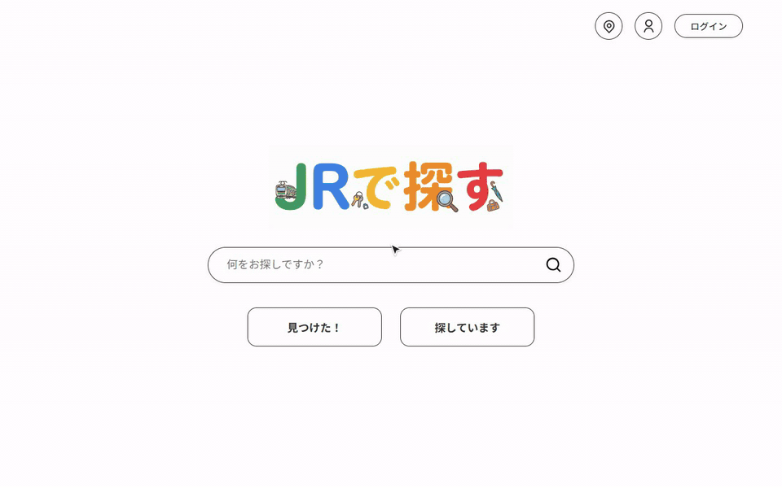

먼저 볼 곳

- 검색: 저장할 때 NFKC·소문자로 맞춘 검색용 컬럼만 비교 → [KeywordCondition.java](src/main/java/com/example/jrfind/repository/KeywordCondition.java), [성능](#성능)
- 삭제·권한: 없는 글·삭제된 글은 404, 권한 없는 수정·삭제는 403 → [JrfindController.java](src/main/java/com/example/jrfind/controller/JrfindController.java), 동시 수정·삭제에 대비한 조건부 UPDATE → [JdbcJrfindRepository.java](src/main/java/com/example/jrfind/repository/JdbcJrfindRepository.java)
- 시도 횟수 제한: 4자리 비밀번호와 로그인은 5번 틀리면 5분 잠금 (ID를 바꿔도 같은 IP에서 20번이면 그 IP를 잠금) → [PasswordAttemptLimiter.java](src/main/java/com/example/jrfind/service/PasswordAttemptLimiter.java), [LoginAttemptGuard.java](src/main/java/com/example/jrfind/config/LoginAttemptGuard.java)
- 테스트: 화면을 거치지 않는 직접 요청까지 MockMvc로 확인 → [JrfindControllerTest.java](src/test/java/com/example/jrfind/controller/JrfindControllerTest.java)

## 화면

<table>
  <tr>
    <td width="50%">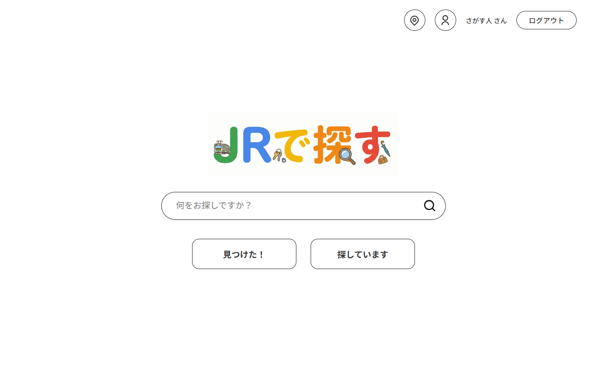<br>홈 — 통합 검색창과 두 게시판 입구</td>
    <td width="50%">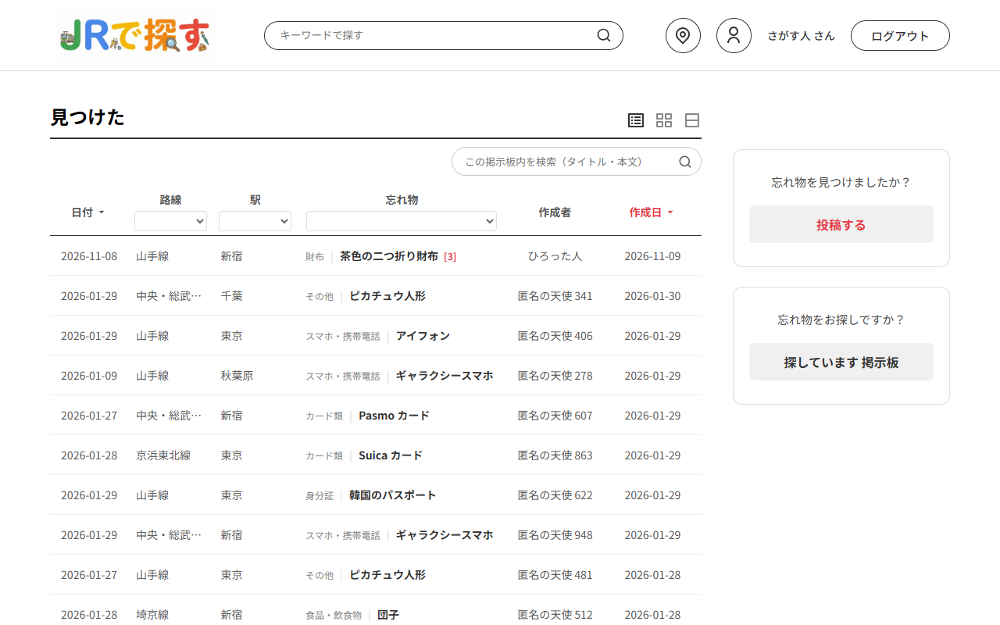<br>見つけた 목록 — 게시판 안 검색, 노선·역·카테고리 필터, 정렬, 댓글 수</td>
  </tr>
  <tr>
    <td>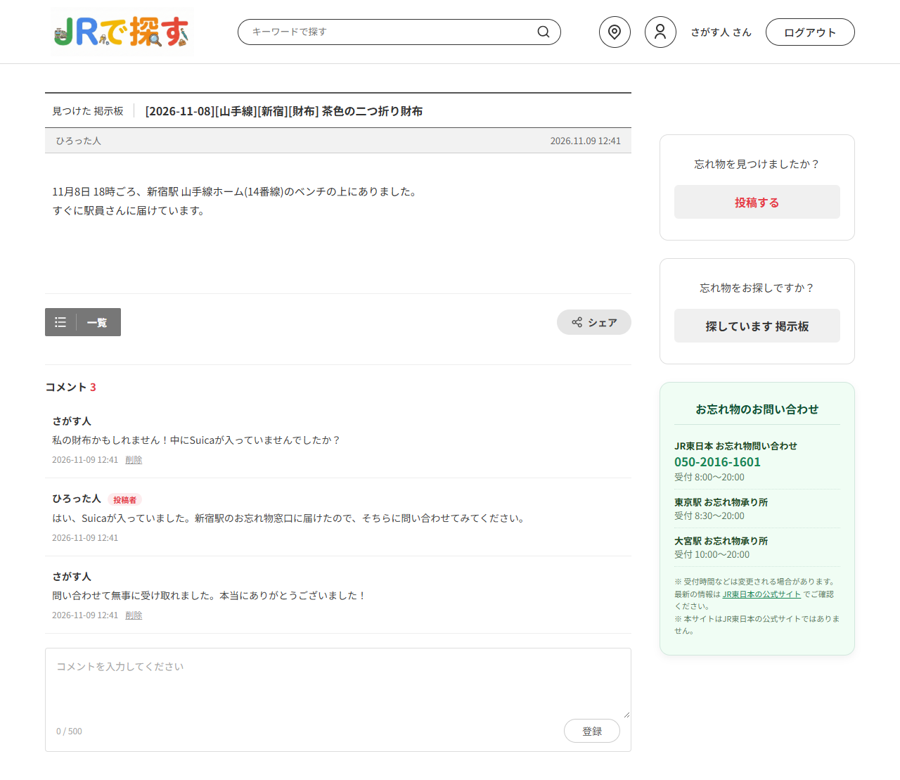<br>見つけた 상세 — 댓글(글쓴이는 「投稿者」 표시), お忘れ物 문의처</td>
    <td>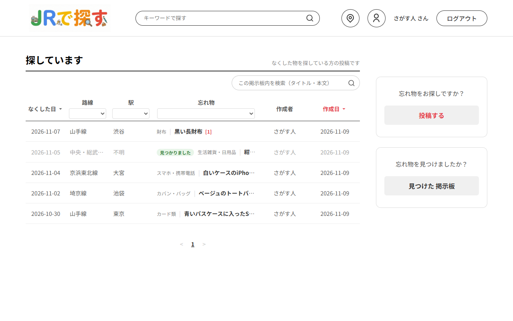<br>探しています 목록 — 찾은 물건은 「見つかりました」 표시</td>
  </tr>
  <tr>
    <td>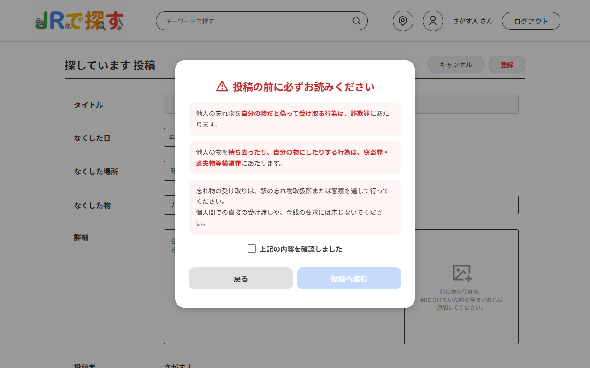<br>探しています 작성 전 주의사항 — 사기·절도 경고를 확인해야 작성 가능</td>
    <td>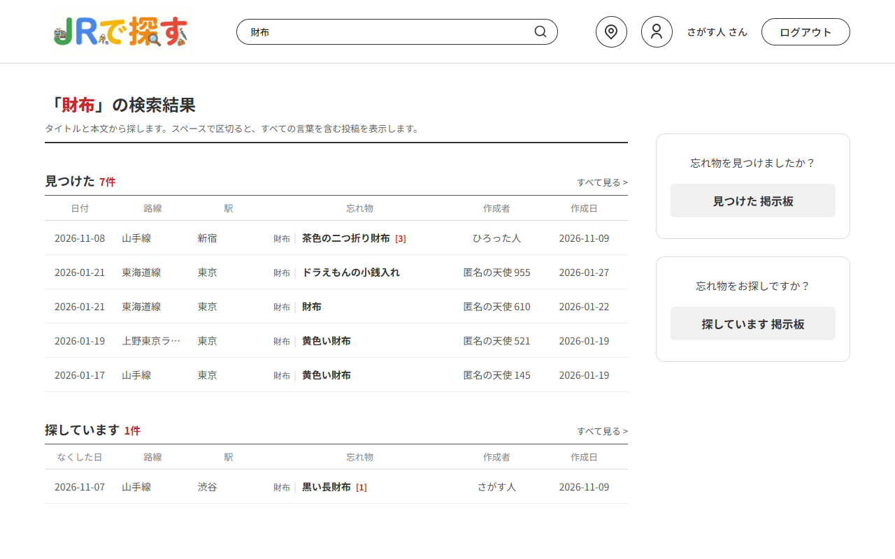<br>통합 검색 — 두 게시판에서 최신 5건씩</td>
  </tr>
  <tr>
    <td>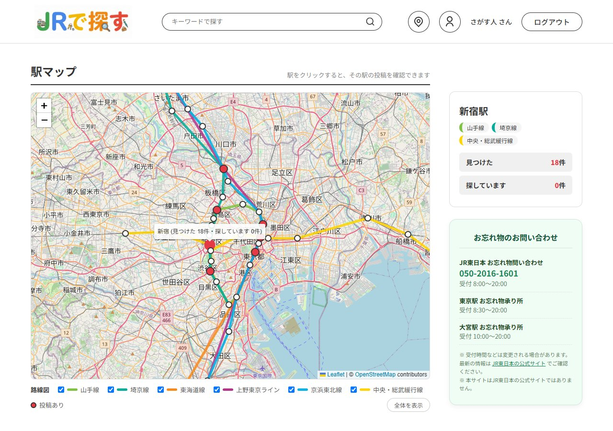<br>駅マップ — 노선도와 역별 게시글 수, お忘れ物 문의처</td>
    <td>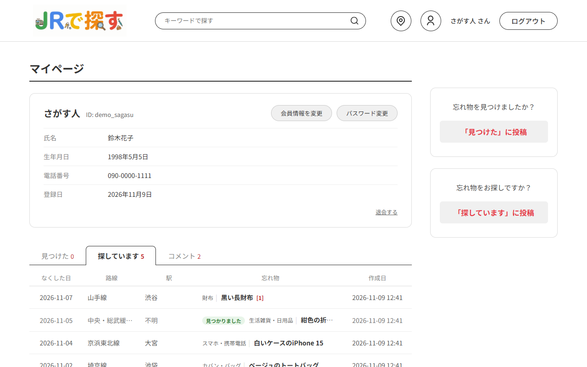<br>마이페이지 — 내 회원정보와 내가 쓴 글·댓글</td>
  </tr>
</table>

휴대폰 화면 (폭 390px)

<table>
  <tr>
    <td width="33%">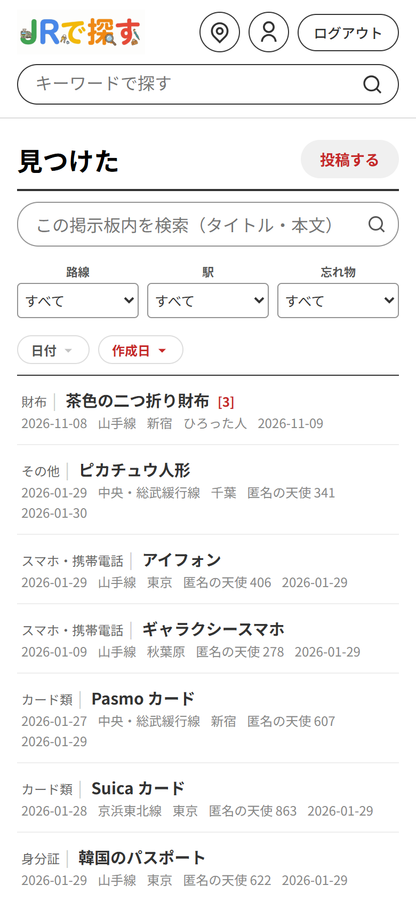<br>목록 — 표를 카드 형태로</td>
    <td width="33%">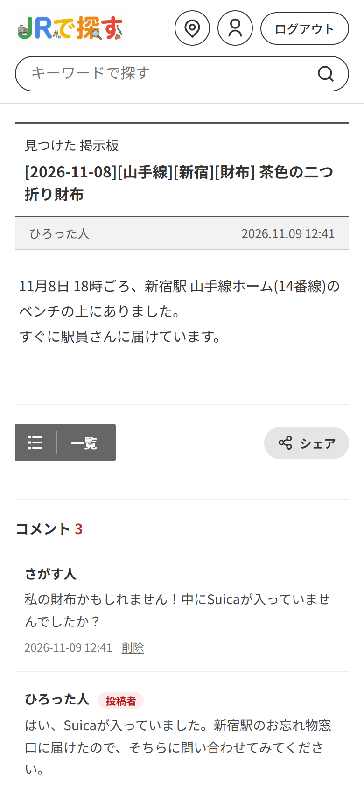<br>상세</td>
    <td width="33%">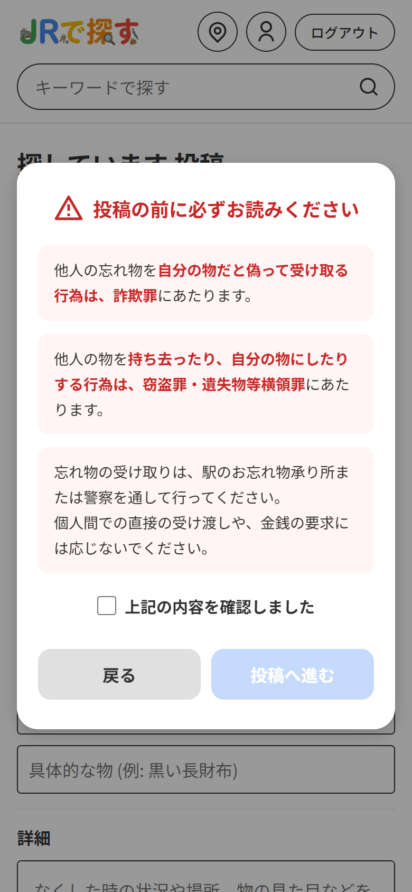<br>探しています 작성 전 주의사항</td>
  </tr>
</table>

스크린샷의 게시글·회원 정보는 모두 테스트용 데이터입니다.

## 기술 스택

- Java 21, Spring Boot 4.0 (Spring MVC, Spring Security, JDBC, Validation)
- Thymeleaf, HTML / CSS / JavaScript, flatpickr, Leaflet + OpenStreetMap (駅マップ)
  - flatpickr·Leaflet 은 WebJars 로 jar 에 포함해 앱에서 직접 제공 (외부 CDN 이 막혀도 동작, 버전은 `pom.xml` 에서 관리)
- H2 Database (파일 모드)
- Maven

## 실행 방법

Java 21이 필요합니다.

```bash
./mvnw spring-boot:run        # Windows: mvnw.cmd spring-boot:run
```

브라우저에서 http://localhost:8080 에 접속합니다.

- 처음 실행하면 `data/` 폴더에 H2 DB가 만들어지고, `schema.sql`·`data.sql`로 테이블과 노선·역·카테고리 데이터가 들어갑니다.
- 업로드한 이미지는 `uploads/` 폴더에 저장됩니다.
- H2 콘솔은 기본으로 꺼져 있습니다. 환경변수 `JRFIND_H2_CONSOLE=true`로 켜면 http://localhost:8080/h2-console 에서 볼 수 있습니다 (이 PC에서만 접속 가능. JDBC URL `jdbc:h2:file:./data/jrfinddb`, 사용자 `sa`, 비밀번호 없음)

설정은 환경변수로 바꿀 수 있습니다.

| 환경변수 | 기본값 | 설명 |
|---|---|---|
| `SPRING_DATASOURCE_URL` | `jdbc:h2:file:./data/jrfinddb;AUTO_SERVER=TRUE` | DB 접속 URL |
| `SPRING_DATASOURCE_USERNAME` / `SPRING_DATASOURCE_PASSWORD` | `sa` / (없음) | DB 계정 |
| `JRFIND_UPLOAD_DIR` | `./uploads` | 이미지 저장 폴더 |
| `JRFIND_H2_CONSOLE` | `false` | H2 콘솔 사용 여부 (개발용) |

테스트: `./mvnw test` (메모리 DB 사용)

## 주요 기능 (見つけた 게시판)

- 게시글 목록: 노선·역·카테고리 필터, 발견일·작성일 정렬, 페이지네이션 (15건씩)
  - 글·정렬·페이지 번호는 서버가 만든 링크, 필터는 폼이라 키보드(Tab·Enter)·새 탭·JS 를 끈 브라우저에서도 동작
  - 필터는 마우스로 고르면 바로 적용하고, 키보드로 고를 때는 「絞り込む」로 적용 (↑↓ 로 값을 바꾸는 중에 화면이 바뀌지 않도록)
  - 페이지 번호는 처음·끝과 지금 페이지 앞뒤 2쪽만. 상세 화면의 「一覧」은 보던 목록(필터·정렬·페이지)으로 돌아감
- 게시글 등록: 달력으로 발견일 선택, 노선에 따라 역 목록 변경, 제목 자동 생성, 사진 첨부
- 비회원 글: 작성자 이름 자동 부여 (`匿名の天使 001` 형식, 쓰지 않는 번호 중에서. 1,000개가 다 차면 아무 번호나), 4자리 비밀번호 확인 후 수정·삭제
  - 저장하면 확인이 풀리므로, 다른 탭에서 먼저 저장했거나 저장 후 「뒤로」로 돌아와 다시 보내면 입력한 내용을 보관해 두고 비밀번호를 다시 물은 뒤 수정 화면에 채움
- 회원 글: 닉네임으로 표시, 작성자 본인만 수정·삭제 (삭제는 모두 논리 삭제)

## 探しています 게시판

- 목록·상세는 누구나 볼 수 있고, 작성·수정·삭제는 회원만 가능 (로그인 전이면 안내 문구와 함께 로그인 화면으로 이동하고, 로그인 후 원래 화면으로 돌아옴)
- 글쓰기 전에 주의사항(사기·절도 경고)을 확인해야 작성 가능 (서버에서도 확인 여부 검사)
- 잃어버린 역을 모르면 「駅がわからない」 선택 가능 (제목에는 `駅不明`으로 표시)
- 작성자는 물건을 찾으면 「見つかりました」로 표시 (목록·상세에 표시, 해제 가능)
- 목록 필터·정렬·페이지네이션, 사진 첨부는 見つけた 게시판과 같음
- 입력 오류로 화면이 다시 표시돼도 입력값 유지

## 댓글 (두 게시판 공통)

- 댓글은 누구나 볼 수 있고, 작성은 회원만 가능 (로그인 전이면 「ログイン」 링크 → 로그인 후 그 게시글의 댓글 위치로 돌아옴)
- 댓글을 쓴 본인만 삭제 가능 (논리 삭제). 게시글 작성자가 쓴 댓글에는 「投稿者」 표시
- 최대 500자, 빈 댓글은 화면과 서버 양쪽에서 막고, 오류가 나도 입력한 내용은 유지
- 목록 화면의 물건 이름 옆에 댓글 수 표시
- 댓글이 많은 글은 최근 50건만 보여 주고, 그 위의 「以前のコメント(N件)をすべて表示」로 모두 보기 (마이페이지의 내 댓글 링크는 모두 보는 주소로)
- 댓글 테이블 하나를 두 게시판이 같이 사용 (`FOUNDITEMID` / `LOSTITEMID` 중 하나에만 값이 들어가도록 CHECK 제약)

## 검색

- 헤더·홈 화면의 검색창 → 통합 검색 화면 (`/search?q=`): 두 게시판에서 최신 5건씩과 전체 건수, 「すべて見る」로 각 게시판 목록 이동
- 각 게시판 목록 위의 검색창 → 그 게시판 안에서만 검색 (지금 고른 필터·정렬은 그대로, 1페이지부터). 빈 칸으로 검색하면 검색어만 해제
- 게시판 목록에서는 검색어(`?q=`)와 노선·역·카테고리 필터, 정렬, 페이지 이동을 함께 사용 (「検索をやめる」로 검색어만 해제)
- 제목(날짜·노선·역·카테고리·물건 이름 포함)과 본문에서 찾음. 공백(전각 포함)으로 나눈 단어는 모두 포함하는 글만 (최대 5단어, 넘으면 화면에 안내)
- 대소문자 구분 없음, `%` `_` 는 와일드카드가 아니라 글자 그대로 검색 (LIKE 이스케이프)
- 전각·반각 구분 없음 (ｽﾏﾎ ↔ スマホ, Ｓｕｉｃａ ↔ suica, （予定） ↔ (予定)): 글을 저장할 때 제목+본문을 NFKC·소문자로 맞춘 검색용 컬럼(`SEARCHTEXT`)을
  함께 저장하고, 검색어도 같은 방법으로 맞춰 그 컬럼 하나만 비교 (검색할 때마다 모든 글을 변환하지 않음). 이 컬럼이 없던 DB 의 글은 서버를 켤 때 채움

## 회원가입·로그인

- 회원가입: ID, 비밀번호, 氏名, ニックネーム(선택, 비우면 氏名), 生年月日, 電話番号, 개인정보 취급 동의
- 입력 오류는 항목별로 표시하고 입력값은 유지 (ID 중복, 비밀번호 확인 불일치 포함)
- ID 는 대소문자를 구분하지 않고 하나만 (가입 화면에서 확인하고, 동시에 가입하는 경우는 DB 유일 인덱스로 막음)
- 로그인·로그아웃은 Spring Security 폼 로그인 사용. 로그인 실패 시 ID와 비밀번호 중 무엇이 틀렸는지 구분하지 않음
- 연속으로 틀리면 잠시 로그인을 제한하고 안내 문구 표시 (기준은 아래 「보안 처리」). 잠기기까지 3번 이하로 남으면 남은 횟수를 미리 안내

## 마이페이지 (`/mypage`, 회원만)

- 헤더의 유저 아이콘·닉네임으로 이동. 내 회원정보와 내가 쓴 글(見つけた / 探しています)·댓글을 탭별로 10건씩 표시
- 댓글 탭에서 누르면 그 게시글의 해당 댓글 위치로 이동 (삭제된 게시글의 댓글은 제외)
- 회원정보 변경 (氏名・ニックネーム・生年月日・電話番号, ID는 변경 불가): 닉네임을 바꾸면 지금까지 쓴 글·댓글의 작성자명도 함께 변경 (트랜잭션), 다시 로그인하지 않아도 헤더에 바로 반영
- 비밀번호 변경: 현재 비밀번호 확인 (5회 연속 실패 시 5분간 잠금), 새 비밀번호 규칙·확인 일치 검사
- 退会 (`/mypage/withdraw`): 비밀번호 재확인 + 주의 사항 확인 체크 + 확인 대화상자
  - 회원정보(ID·비밀번호·氏名・生年月日・電話番号)는 삭제하고, 글·댓글은 남겨 작성자명을 「退会したユーザー」로 변경 (트랜잭션)
  - 탈퇴 화면에 남아 있는 내 글·댓글 수를 보여 줘서, 지우고 싶은 글은 탈퇴 전에 지울 수 있게 함
  - 다른 브라우저·기기에 로그인해 둔 세션도 함께 종료 (Spring Security `SessionRegistry`)
  - 같은 ID 로 다시 가입할 수 있지만 예전 글·댓글과는 연결되지 않음 (글·댓글은 회원 번호로 연결)
  - 「退会したユーザー」는 닉네임으로 쓸 수 없음 (「匿名の天使」로 시작하는 이름과 같은 처리. 공백·보이지 않는 글자를 넣거나 반각 카나로 써도 같음)
  - DB 에서도 CHECK 제약으로 "탈퇴하지 않은 회원은 개인정보가 모두 있고, 탈퇴한 회원은 모두 비어 있음"을 보장

## 駅マップ (`/map`)

- 헤더·홈 화면의 지도 아이콘으로 이동. Leaflet + OpenStreetMap 지도 (API 키 불필요)
- 역마다 마커 표시 (게시글이 있는 역은 빨간색), 역을 누르면 지나는 노선과 見つけた / 探しています 게시글 수, 해당 역으로 거른 게시판 목록 링크
- 노선도: 노선별 색으로 역을 순서대로 이은 선 (범례 체크박스로 노선별 표시·숨김), 「全体を表示」로 전체 노선 범위 보기
- 역 위치는 `STATION_LOCATION` 테이블 (`data.sql`, HeartRails Express API 에서 조회한 좌표), 지도 데이터는 `/map/stations` (JSON)
- お忘れ物 문의처 안내 (JR東日本 お忘れ物問い合わせ 번호·受付時間, 東京駅・大宮駅 お忘れ物承り所): 지도와 두 상세 화면 사이드바에 공통 표시. JR東日本 공식 사이트의 정보이며, 바뀔 수 있다는 안내와 공식 페이지 링크를 함께 둠

## 휴대폰 화면

- 모든 화면에 viewport 를 지정하고, 공통 스타일 `static/css/mobile.css` (폭 768px 이하에서만 적용)로 휴대폰에 맞게 배치
- 태블릿 폭(769~1024px): 목록은 사이드바를 아래로 옮겨 표를 넓게 (날짜·작성일이 잘리지 않도록), 헤더 검색창은 남는 폭만큼
- 헤더는 로고·아이콘을 한 줄에, 검색창은 아래 줄 전체로. 본문과 사이드바는 세로로 (게시판 목록에서는 제목 옆에 「投稿する」)
- 목록 표는 카드 형태 (물건 이름을 첫 줄에), 등록·회원 폼은 항목 이름을 입력 칸 위에, 창(모달)은 화면 폭에 맞춤
- PC 화면의 배치는 그대로

## 접근성

- 모든 입력 칸에 이름(`label` 또는 `aria-label`)을 붙이고, 형식 안내·오류 문구는 `aria-describedby` 로 그 칸에 연결. 서버 검증에서 걸리면 첫 번째로 틀린 칸으로 포커스
- 확인 창(모달)은 `role="dialog"`, 열면 창 안으로 포커스를 옮기고 Tab 은 창 안에서만, Esc 로 닫고 닫으면 원래 자리로 (js/dialog.js)
- 상세 화면의 수정·삭제 버튼은 링크(`?verify=edit`, `?confirmDelete`): JS 가 있으면 화면 안에서 창을 열고, 없으면 서버가 창을 연 화면을 돌려줌.
  비회원 글의 비밀번호 창도 폼이라 JS 없이 확인 가능 (`POST /items/{id}/verify`). Enter 로 확인, 4자리 숫자가 아니면 틀린 횟수로 세지 않음(전각 숫자는 반각으로)
- 사진 첨부는 숨긴 파일 칸 + `label` 이라 키보드(Tab → Enter)로도 고를 수 있음. 입력 칸·버튼에 포커스 표시
- JS 를 꺼도 글 열람·등록이 가능: 목록은 링크와 GET 폼, 역 선택은 처음부터 고를 수 있고, 서버 검증 안내는 화면에 그대로 표시.
  探しています 작성 전 주의사항은 JS 가 있으면 처음에 창으로, 없으면 폼 위에 표시 (체크 칸이 그대로 확인 값)
- 입력 중에 다른 화면으로 나가면 확인 (화면 안 링크는 이 화면의 창, 뒤로 가기·새로고침·탭 닫기는 브라우저의 확인 창). 입력이 없으면 묻지 않음
- 입력 오류로 다시 그린 화면(POST 응답)에서 새로고침·뒤로 가기를 해도 폼을 다시 보내지 않음: 방문 기록을 주소창의 주소로 바꿔 둠 (`history.replaceState`, JS 가 꺼져 있으면 브라우저 기본 동작)
- 화면마다 제목은 h1 하나, 헤더 앞에 「本文へ移動」(첫 Tab), 아이콘만 있는 링크·버튼에 이름, 장식용 SVG 는 읽지 않게(`aria-hidden`)
- 駅マップ: 지도 옆의 「駅を選ぶ」로 키보드·스크린리더에서도 역을 고를 수 있음 (역 마커 47개는 Tab 순서에서 뺌). 지도를 불러오지 못하거나 JS 가 꺼져 있으면 안내하고, 역 고르기는 게시판 목록으로 가는 폼으로 동작
- 글자색은 배경과 4.5:1 이상, 공통 스타일의 글자 크기는 rem (브라우저의 글자 크기 설정을 따름), 고대비 모드에서 창·버튼 테두리 표시

## 보안 처리

- 비밀번호(회원·비회원 글 모두)는 BCrypt 해시로 저장하고, 화면(HTML)에는 내보내지 않음
- 콘텐츠 보안 정책(CSP): 스크립트는 이 사이트의 파일만 (`script-src 'self'`). 화면에 인라인 스크립트·`on…` 속성이 없어서
  게시글 등에 스크립트가 끼어들어도 실행되지 않음 (테스트가 모든 화면을 검사). 다른 사이트의 iframe 에는 넣지 못하게(`frame-ancestors 'none'`)
- 모든 POST 요청에 CSRF 토큰 확인 (폼은 hidden 값, fetch 는 헤더로 전송)
  - 로그인하지 않고 글을 보기만 할 때는 토큰을 만들지 않아 세션도 생기지 않음 (방문자·검색 로봇마다 세션이 쌓이지 않도록).
    비회원 글의 비밀번호 확인은 보내기 직전에 `GET /csrf` 로 토큰을 받음
  - 화면을 오래 열어 둬서 토큰이 맞지 않으면 403 대신 보던 화면으로 돌아가 안내. 등록·수정·댓글은 입력한 내용을 보관했다가
    같은 폼을 다시 열 때 채움 (로그인이 끝났으면 다시 로그인한 뒤, 비회원 글은 비밀번호를 다시 확인한 뒤). 보관은 한 세션에 하나, 2,000자까지
- 수정·삭제 권한은 서버에서 검사: 회원 글은 작성자 본인, 비회원 글은 "비밀번호 확인을 통과한 세션", 댓글은 쓴 본인 (화면 JS 검사만으로 막지 않음)
- 비밀번호 5회 연속 실패 시 5분간 잠금 (4자리 비밀번호 무차별 대입 방지). 3번 이하로 남으면 남은 횟수를, 잠기면 잠긴 시간을 안내
  - 없는 글·삭제된 글·회원 글에 대한 확인은 404 로 돌려주고 틀린 횟수로 세지 않음 (다른 탭에서 지운 글에 맞는 비밀번호를 넣어도 잠기지 않음)
- 로그인 연속 실패 제한 (잠긴 동안은 맞는 비밀번호도 확인하지 않음)
  - 같은 접속 IP 에서 같은 ID 로 5회 틀리면 그 IP 에서 그 ID 의 로그인을 5분간 막음
  - ID 를 바꿔 가며 틀려도 같은 IP 에서 20회가 되면 그 IP 의 로그인을 5분간 막음 (자기 계정에 로그인해도 이 횟수는 지워지지 않음)
  - ID 만으로 잠그지 않고 접속 IP 와 묶어서 세므로, 다른 사람이 일부러 틀려도 다른 곳의 주인은 계속 로그인할 수 있음
  - 없는 ID 도 똑같이 세고 똑같이 잠그므로 잠금 여부로 ID 가 있는지 알 수 없음
- 업로드 파일은 파일 앞부분(매직 넘버)으로 실제 이미지인지 확인하고, 원본 파일명 대신 서버에서 만든 이름으로 저장 (경로 조작 방지)
- JPG 사진은 다시 저장해서 촬영 정보(EXIF: 촬영 위치 GPS·기종 등)를 지움. 휴대폰 사진의 회전 정보는 지우기 전에 픽셀에 반영
- 해상도가 5,000만 화소를 넘는 그림은 크기만 읽고 거부 (작은 파일로 서버 메모리를 다 쓰게 하는 그림)
- 사진을 바꾸거나 지우면 이전 이미지 파일을, 게시글을 삭제하면 그 글의 이미지 파일을 업로드 폴더에서 삭제
  (삭제한 글의 사진이 `/images/파일명` 주소로 계속 보이지 않도록. DB 반영 후에 지우고, 업로드 폴더 밖의 파일은 지우지 않음).
  저장 도중 서버가 멈추는 등으로 남은 파일은 매일 새벽 4시에 정리 (어느 글도 쓰지 않고 1시간 이상 지난 파일)
- 같은 글을 동시에 수정·삭제해도 한쪽만 반영: 수정·삭제는 "삭제되지 않았고 사진이 읽었을 때 그대로"인 경우만 반영하는 조건부 UPDATE.
  늦은 쪽의 수정은 안내 후 다시 하도록 하고 새로 저장한 사진은 지움 (지운 글에 사진이 공개된 채 남거나, 쓰이지 않는 파일이 쌓이지 않도록)
- 댓글은 게시글이 삭제되지 않았을 때만 넣음 (확인과 저장을 INSERT … SELECT 한 문장으로)
- 입력값은 서버에서도 다시 검증 (Bean Validation + 노선·역·카테고리 실존 여부)
  - 검증 전에 정리: 줄바꿈은 LF 로, 앞뒤의 공백(전각·NBSP)과 폭 없는 글자는 지우고, 글자 방향을 바꾸는 제어 문자(U+202E 등)는 어디에 있든 지움
    (보이지 않는 글자만 넣은 물건 이름이 등록되거나, 목록에서 글자가 거꾸로 보이던 문제)
- 같은 접속자가 같은 곳에 같은 내용을 10분 안에 다시 보내면 한 번만 저장 (게시글 등록·댓글. 등록 후 「뒤로」로 돌아와 다시 보내거나 버튼을 연달아 누른 경우)
- 세션 쿠키 `HttpOnly`, `SameSite=Lax`, URL에 세션 ID 노출 안 함

## 성능

글 1만 건(見つけた 10,000 · 探しています 3,400)과 댓글 300건이 달린 글이 있는 DB 로, 개선 전후의 서버를 같은 PC 에서 번갈아 요청해 비교한 값 (중앙값, 3회 측정).
글·댓글이 계속 쓰이는 게시판과 같은 조건이 되도록 H2 가 같은 조회 결과를 다시 쓰지 않게 했고, 절대값은 PC 상태에 따라 달라지므로 배수로 보는 것이 정확함.

| 화면 | 개선 전 | 개선 후 | |
|---|---:|---:|---:|
| 게시판 검색 (`/items?q=財布`) | 271 ms | 36 ms | 7.6배 |
| 게시판 검색 (반각 카나 `ｽｲｶ`) | 497 ms | 36 ms | 14배 |
| 통합 검색 (전각 5단어) | 984 ms | 43 ms | 23배 |
| 통합 검색 (가장 느린 경우: `ｰ` 5단어) | 2,891 ms | 38 ms | 76배 |
| 見つけた 목록 1페이지 | 63 ms | 33 ms | 1.9배 |
| 댓글 300건인 글의 상세 (HTML) | 274 KB | 66 KB | |
| 목록 첫 방문 전송량 (HTML·CSS·JS·로고) | 316 KB | 26 KB | |
| 같은 화면 두 번째 방문 | CSS·JS·로고 다시 받음 | HTML 만 받음 | |
| 휴대폰 사진(4032×3024, 9.4MB) 업로드 후 상세에서 받는 크기 | 9.4 MB | 273 KB | |

- 검색: 검색용 컬럼(`SEARCHTEXT`) 하나만 비교. 예전에는 검색할 때마다 모든 글의 제목·본문을 `LOWER(TRANSLATE(…))` 로 바꾸고, 단어마다 조건이 2~4개였음
- 목록: 작성일·발견일 + ID 인덱스로 한 페이지만 읽음 (예전에는 모든 글의 댓글 수를 센 뒤 정렬). 노선·역·카테고리는 처음 한 번만 읽어 둠
- 정적 파일: 응답 압축(gzip), CSS·JS·로고는 주소에 파일 내용의 해시를 붙이고(`mobile-<해시>.css`) 1년 동안 캐시. 로고는 표시 크기에 맞춘 파일(265KB → 10KB)
- 사진: 긴 변 1,280px 로 줄여 저장 (업로드 처리는 1200만 화소 사진에서 약 0.9초 늘어남)
- 상세 화면: 최근 댓글 50건만

## 폴더 구조

```
src/main/java/com/example/jrfind
├─ JrFindApplication.java
├─ config/       SecurityConfig (로그인·CSRF), LoginAttemptGuard (로그인 연속 실패 제한),
│                ExpiredFormHandler (오래 열어 둔 폼을 보냈을 때 안내), WebMvcConfig (업로드 이미지·로고 경로·캐시),
│                CacheConfig (노선·역·카테고리를 메모리에)
├─ controller/   JrfindController (見つけた), LostItemController (探しています), CommentController (댓글),
│                SearchController (통합 검색), MemberController, MyPageController (마이페이지),
│                MapController (駅マップ), LoginMemberAdvice (헤더용 로그인 정보),
│                BoardQuery (목록 조건을 유지한 링크 주소),
│                VerifiedItems (비밀번호 확인 상태 · 세션), FormDraft (보내지 못한 입력 보관 · 세션),
│                SubmittedForms (같은 내용 중복 등록 방지 · 세션), CsrfController (JS 가 보내기 직전에 받는 CSRF 토큰)
├─ domain/       FoundItem, FoundItemForm, LostItem, LostItemForm, Comment, CommentForm, Board,
│                Member, SignupForm, ProfileForm, PasswordForm, WithdrawForm, LoginMember, Category, Station,
│                StationLocation, MapData, Texts (입력 문자열 정리)
├─ repository/   JrfindRepository, LostItemRepository, CommentRepository, MemberRepository (+ JdbcTemplate 구현),
│                KeywordCondition (검색어 SQL 조건·검색용 값), SearchTextBackfill (비어 있는 검색용 컬럼 채우기)
└─ service/      JrfindService, LostItemService, CommentService, MemberService, MapService,
                 ImageStorage, ImageResizer (사진 축소·촬영 정보 삭제), OrphanImageCleaner (쓰이지 않는 사진 정리),
                 PasswordAttemptLimiter
src/main/resources
├─ schema.sql, data.sql, messages.properties (입력 형식 오류 문구)
├─ static/       css/mobile.css (휴대폰 화면), css/board-list.css · js/board-list.js (두 게시판 목록 공통),
│                css/post-detail.css · js/post-detail.js (상세 화면 공통),
│                css/post-form.css · js/post-form.js (등록·수정 화면 공통), js/dialog.js (확인 창),
│                js/member-form.js (회원 화면), js/comments.js (댓글), js/js-enabled.js,
│                js/submit-once.js (두 번 전송 방지),
│                js/page-restore.js (뒤로 가기로 돌아온 화면 처리),
│                js/date-input.js (날짜 직접 입력 확인), js/share-link.js (「シェア」)
├─ templates/    home, ItemList, itemDetail, registerForm, editForm (見つけた)
│                lostList, lostDetail, lostForm (探しています), search, login, signup,
│                mypage, profileEdit, passwordChange, withdraw (마이페이지), map (駅マップ), error,
│                fragments/header, fragments/comments (두 상세 화면 공통 댓글 영역),
│                fragments/lostCenter (お忘れ物 문의처)
└─ logo/
```

## 앞으로 개선할 점

- ID·비밀번호 찾기 (회원 정보에 이메일이 없어 본인 확인 수단을 먼저 마련해야 함)
- 기획 단계의 발전 기능: 1:1 채팅, 역 인근 위치 선택, 사진 여러 장 첨부
