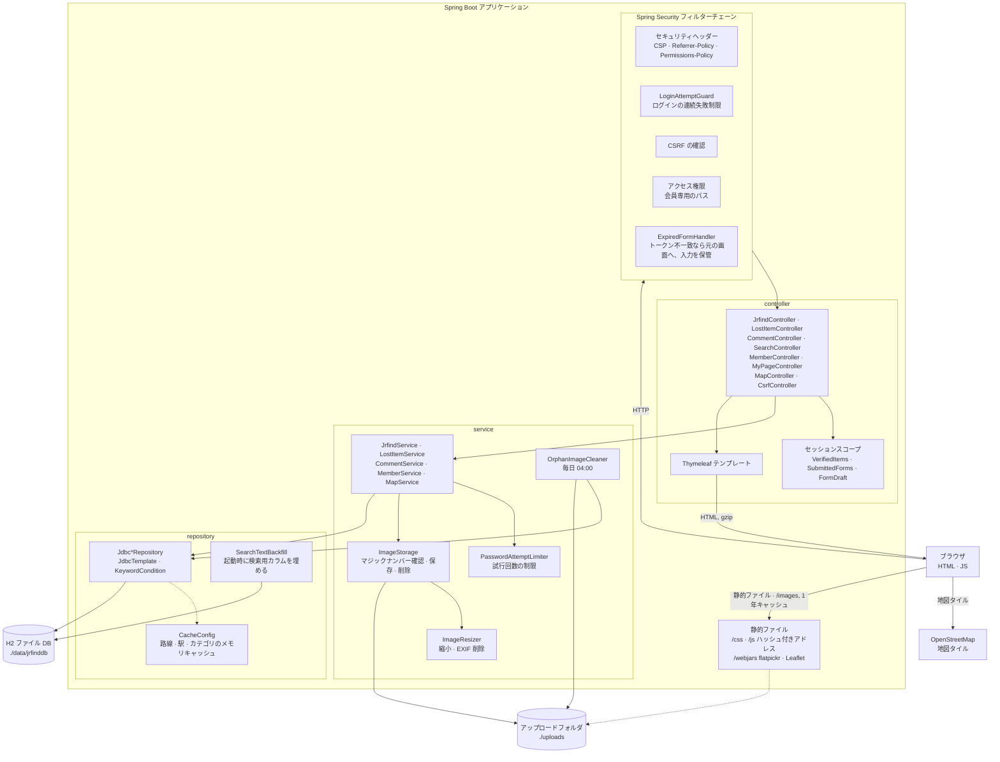
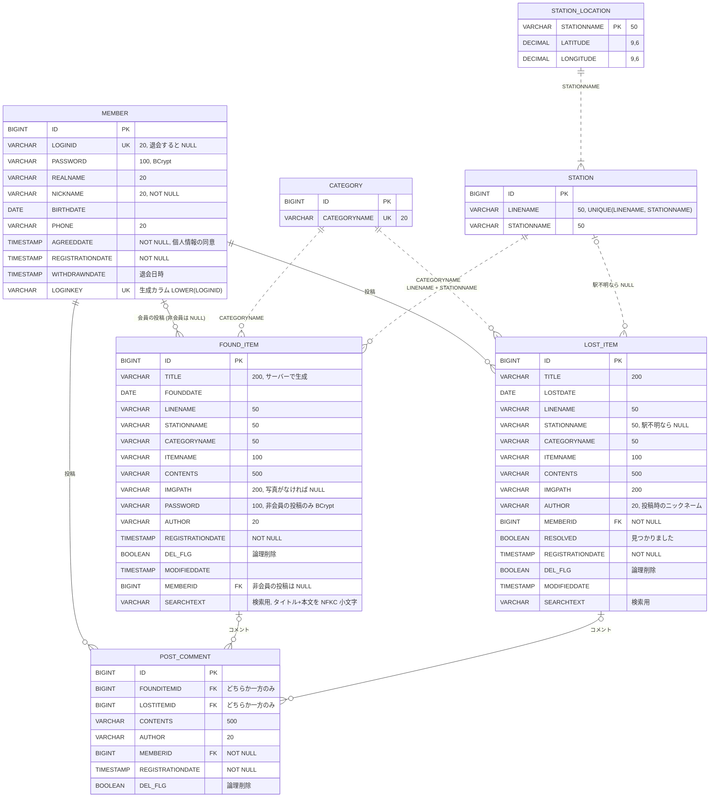
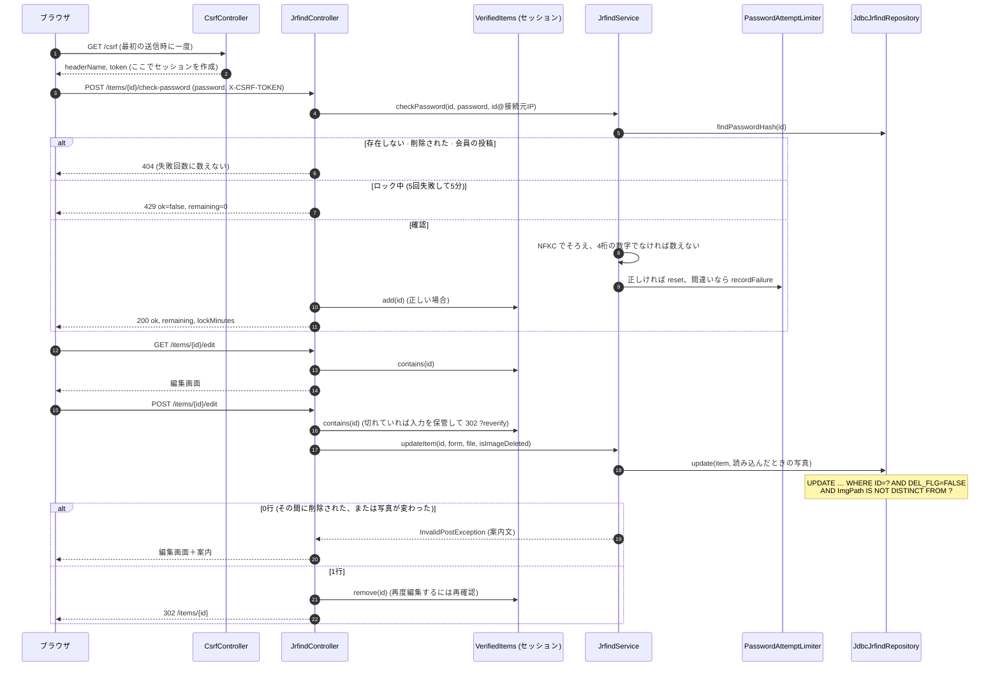
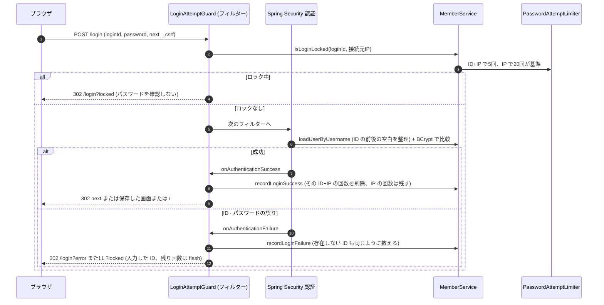
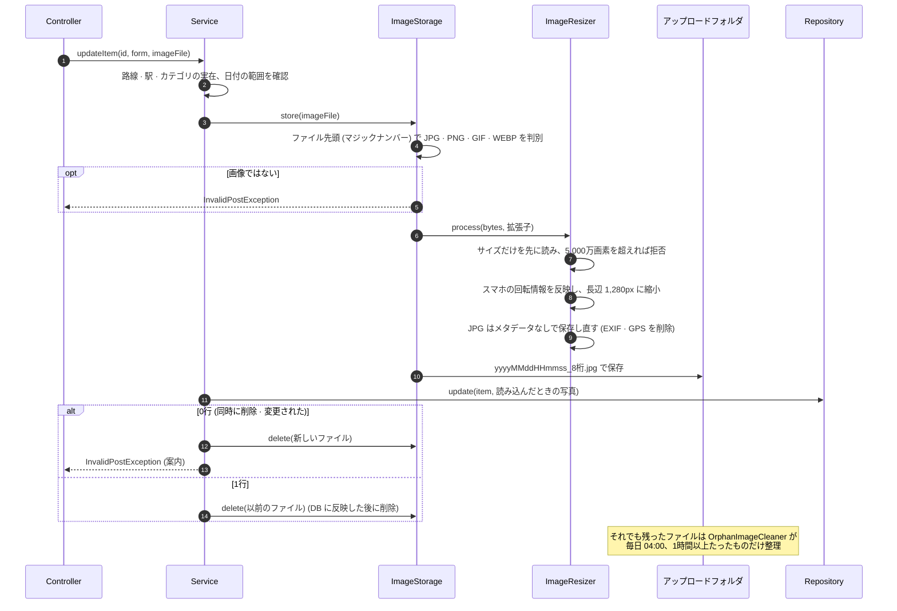

# システム構成・DB 設計

[한국어](ARCHITECTURE.md) | **日本語** · [README](../README.ja.md) · [API 仕様](API.ja.md)

## 目次

- [システム構成](#システム構成)
- [パッケージと役割](#パッケージと役割)
- [DB 設計（ER 図）](#db-設計er-図)
- [主なリクエストの流れ](#主なリクエストの流れ)
- [設計上の判断](#設計上の判断)

## システム構成

サーバーで画面を生成して返す Spring MVC アプリケーションです（Spring Boot 4・Java 21・組み込み Tomcat）。DB はファイルに保存する H2、DB へのアクセスは JdbcTemplate で SQL を直接書いています。

- 画面のスクリプトはすべてファイルで読み込み（`script-src 'self'`）、外部から取得するのは地図タイルの画像だけです。flatpickr・Leaflet は WebJars でプロジェクトに同梱しています。
- CSS・JS・ロゴのアドレスにはファイル内容のハッシュを付け（`mobile-<ハッシュ>.css`）1年間キャッシュし、ファイルを変更するとアドレスが変わります。
- 実行環境の設定：DB のアドレス `SPRING_DATASOURCE_URL`、アップロードフォルダ `JRFIND_UPLOAD_DIR`、H2 コンソール `JRFIND_H2_CONSOLE`（既定はオフ）。

## パッケージと役割

`com.example.jrfind`

| パッケージ | クラス | 役割 |
|---|---|---|
| `config` | `SecurityConfig` | 会員専用のパス、フォームログイン、ログアウト、セッション一覧（SessionRegistry）、CSP などのセキュリティヘッダー |
| | `LoginAttemptGuard` | `POST /login` の前のフィルター＋成功・失敗の処理：ロックの確認、失敗回数の記録、戻り先（`next`） |
| | `ExpiredFormHandler` | CSRF トークンの不一致を、403 ではなく元の画面＋`?expired` へ。入力は `FormDraft` に保管 |
| | `WebMvcConfig` | `/images/**`（アップロードフォルダ）、`/logo/**`（ハッシュ付きアドレス）のパスとキャッシュ |
| | `CacheConfig` | 路線・駅・カテゴリ・駅の位置をメモリに保持するキャッシュ（`@EnableCaching`） |
| `controller` | `JrfindController` · `LostItemController` | 両掲示板の一覧・詳細・登録・編集・削除、非会員の投稿のパスワード確認 |
| | `CommentController` | コメントの登録・削除（両掲示板で共通） |
| | `SearchController` · `MapController` · `MemberController` · `MyPageController` · `CsrfController` | 統合検索、駅マップ、会員登録・ログイン画面、マイページ、CSRF トークン |
| | `VerifiedItems` · `SubmittedForms`（セッションスコープ）、`FormDraft` | パスワード確認を通過した投稿、10分以内の同じ内容の再送信防止、送信できなかった入力の保管 |
| | `BoardQuery` · `LoginMemberAdvice` · `FormErrors` · `SearchKeyword` | 条件を保持した一覧のリンク・ページ番号、全画面共通のログイン情報、エラー文、キーワードの整理 |
| `domain` | `FoundItem` · `LostItem` · `Comment` · `Member` など、`*Form` | データと入力フォーム（Bean Validation）、`Texts`（入力文字列の整理）、`Board`（掲示板の種類） |
| `service` | `JrfindService` · `LostItemService` · `CommentService` · `MemberService` · `MapService` | 業務処理：マスタデータの確認、タイトルの生成、同時変更の処理、ニックネーム変更・退会（トランザクション） |
| | `PasswordAttemptLimiter` | 非会員の投稿のパスワード・ログイン・現在のパスワードの連続失敗ロック（5分） |
| | `ImageStorage` · `ImageResizer` · `OrphanImageCleaner` | 写真の形式確認・縮小・保存・削除、使われない写真の整理 |
| `repository` | `Jdbc*Repository`（インターフェース＋JdbcTemplate による実装） | SQL。条件付き UPDATE・DELETE、`INSERT … SELECT`、一覧の絞り込み・並べ替え・ページ |
| | `KeywordCondition` · `SearchTextBackfill` | 検索条件と検索用の値（NFKC・小文字）、空の検索用カラムを埋める |

## DB 設計（ER 図）

テーブルは7つ（`src/main/resources/schema.sql`）。実線は外部キー、点線は外部キーを使わずアプリケーションで確認する関係です。

### 制約

| テーブル | 制約 | 内容 |
|---|---|---|
| `MEMBER` | `CK_MEMBER_WITHDRAWN`（CHECK） | 退会していない会員は ID・パスワード・氏名・生年月日・電話番号がすべてあり、退会した会員（`WITHDRAWNDATE` あり）はすべて NULL |
| `MEMBER` | `LOGINKEY` 生成カラム＋`UK_MEMBER_LOGINKEY` | `LOWER(LOGINID)` にユニークインデックス → `Taro` と `taro` が同時に登録しても DB で防ぐ。退会した会員は NULL なので複数いてよい |
| `MEMBER` | `LOGINID` UNIQUE | 退会すると NULL（同じ ID で再登録できる） |
| `POST_COMMENT` | CHECK `(FOUNDITEMID IS NULL) <> (LOSTITEMID IS NULL)` | コメントは両掲示板のうち、ちょうど1つの投稿だけに紐づく |
| `CATEGORY` | `CATEGORYNAME` UNIQUE | |
| `STATION` | UNIQUE `(LINENAME, STATIONNAME)` | 同じ駅が複数の路線にあれば、路線ごとに1行 |

### インデックス

| 名前 | 対象 | 用途 |
|---|---|---|
| `IX_FOUND_ITEM_REGDATE` | `FOUND_ITEM(REGISTRATIONDATE, ID)` | 作成日順の一覧（既定の並べ替え） |
| `IX_FOUND_ITEM_FOUNDDATE` | `FOUND_ITEM(FOUNDDATE, ID)` | 発見日順の一覧 |
| `IX_LOST_ITEM_REGDATE` | `LOST_ITEM(REGISTRATIONDATE, ID)` | 作成日順の一覧 |
| `IX_LOST_ITEM_LOSTDATE` | `LOST_ITEM(LOSTDATE, ID)` | なくした日順の一覧 |
| `UK_MEMBER_LOGINKEY` | `MEMBER(LOGINKEY)` | 大文字・小文字を区別しない ID の一意性 |

- 外部キーのカラム（`MEMBERID`、`FOUNDITEMID`、`LOSTITEMID`）には H2 がインデックスを自動で作ります（一覧のコメント数、マイページ）。
- マスタデータ（`data.sql`、起動のたびに `MERGE`）：カテゴリ 11、路線・駅 78行（6路線）、駅の位置 47。
- スキーマは起動のたびに `CREATE … IF NOT EXISTS`／`ALTER … IF NOT EXISTS` で反映するため、以前の DB もそのまま新しい構成になります。

## 主なリクエストの流れ

### 1. 非会員の投稿の編集（4桁パスワードの確認 → セッションに記録 → 条件付き UPDATE）

### 2. 会員ログイン（連続失敗の制限）

### 3. 写真を差し替える編集（形式の確認 → 縮小・EXIF 削除 → 保存 → 条件付き UPDATE → 以前のファイルを削除）

## 設計上の判断

| テーマ | 選択 | 理由 |
|---|---|---|
| DB アクセス | JdbcTemplate（JPA は使わない） | 実習で身につけた方法で、テーブルも7つと小さい構成です。条件付き UPDATE、`INSERT … SELECT`、LIKE のエスケープのように、実行される SQL をそのまま見て制御したい箇所が多くあります。 |
| 同時の編集・削除 | 条件付き UPDATE・DELETE | `WHERE DEL_FLG = FALSE AND ImgPath IS NOT DISTINCT FROM ?` で「読み込んだときのままの場合だけ」反映します。遅れた側には案内し、新しく保存した写真は削除するため、削除した投稿に写真が公開されたまま残ったり、使われないファイルがたまったりしません。削除は写真が変わっていれば読み直し、最大5回試します。 |
| コメントの保存 | `INSERT … SELECT … WHERE DEL_FLG = FALSE` | 投稿の存在確認と保存を1文で行うため、確認の直後に投稿が削除されてもコメントは入りません。 |
| 検索 | 検索用カラム `SEARCHTEXT` | 保存時にタイトル＋本文を NFKC・小文字にそろえておき、キーワードも同じ方法でそろえて1つのカラムだけを比較します。以前は検索のたびに全投稿を `LOWER(TRANSLATE(…))` で変換していたため、投稿1万件で最も遅い検索が約2.9秒かかっていましたが、今は数十 ms です（[README パフォーマンス](../README.ja.md#パフォーマンス)）。 |
| 一覧の並べ替え | `(作成日・発見日・なくした日, ID)` のインデックス | インデックスの順に先頭から1ページ分だけを読みます。インデックスがないと、全投稿のコメント数を数えてから並べ替える必要がありました。同じ日付の投稿がページごとに入れ替わらないよう、ID も一緒に使います。 |
| マスタデータ | `@Cacheable`（メモリ） | 路線・駅・カテゴリ・駅の位置は起動時に `data.sql` でしか変わらないため、最初に一度だけ読みます。変更できない List で返します。 |
| セッション | ログインせずに見るだけなら作らない | CSRF トークンを作るとセッションが作られるため、閲覧画面には入れず、JS が送信するときに `GET /csrf` で受け取ります。訪問者・検索ロボットごとにサーバーのメモリにセッションがたまりません。 |
| 非会員の投稿の権限 | セッションスコープの `VerifiedItems` | パスワード確認の結果を画面（JS）ではなくサーバーのセッションに記録し、編集・削除のリクエストごとにサーバーが確認します。編集が終わると消して、再度確認させます。 |
| 写真 | 形式の確認＋縮小＋EXIF 削除 | 拡張子や Content-Type は書き換えられるため、ファイル先頭で判別します。スマホ写真の撮影場所（GPS）が公開されないよう、JPG は必ず保存し直します。 |
| 画面のスクリプト | すべてファイル、CSP `script-src 'self'` | インラインスクリプト・`on…` 属性をなくし、投稿にスクリプトが紛れ込んでも実行されないようにしました。外部ライブラリは WebJars で同梱しています。 |
