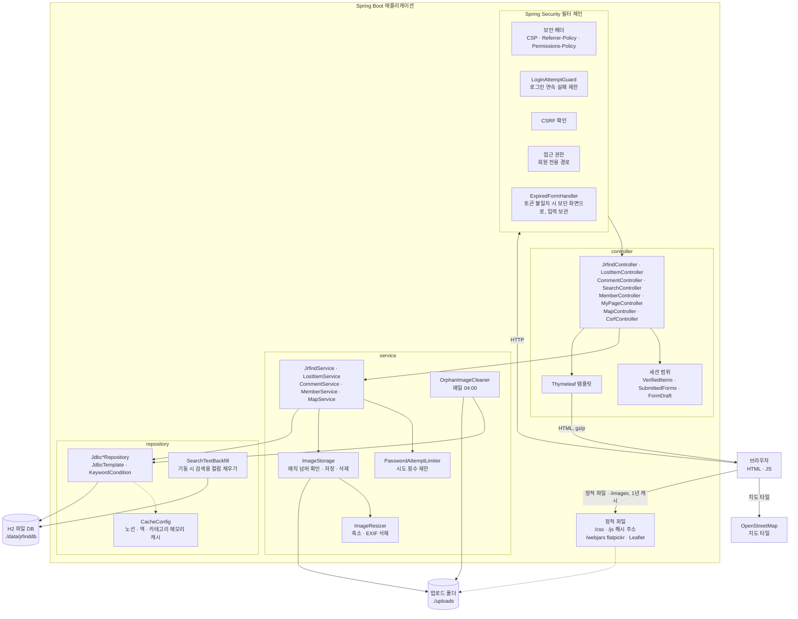
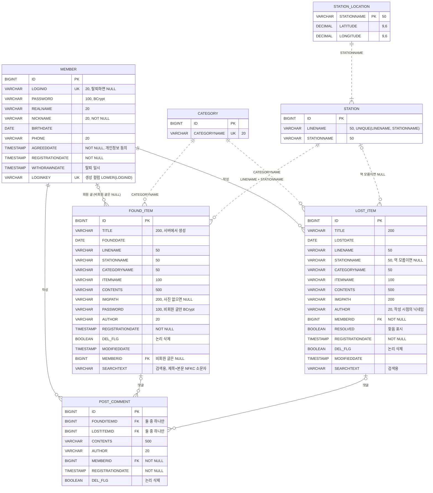
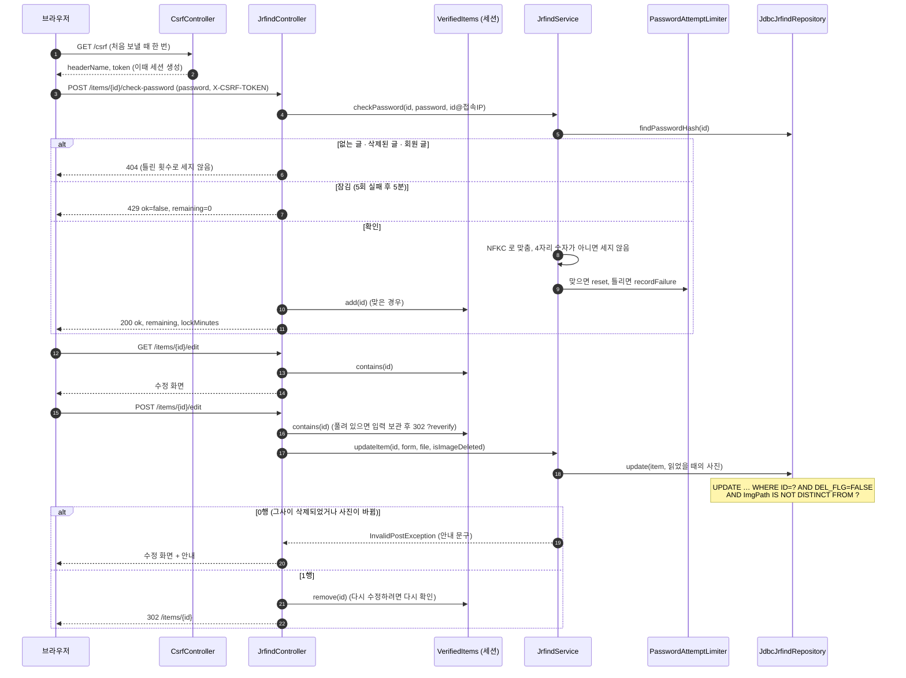
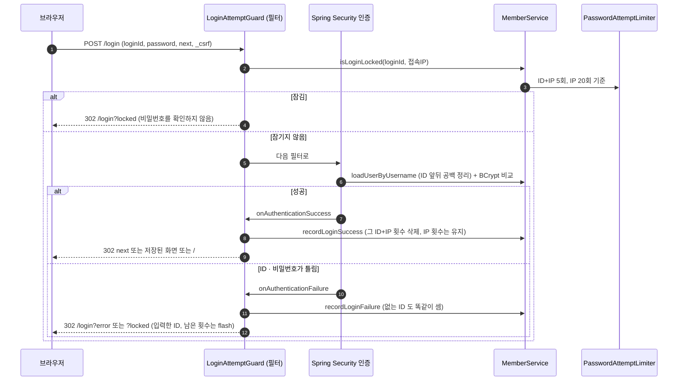
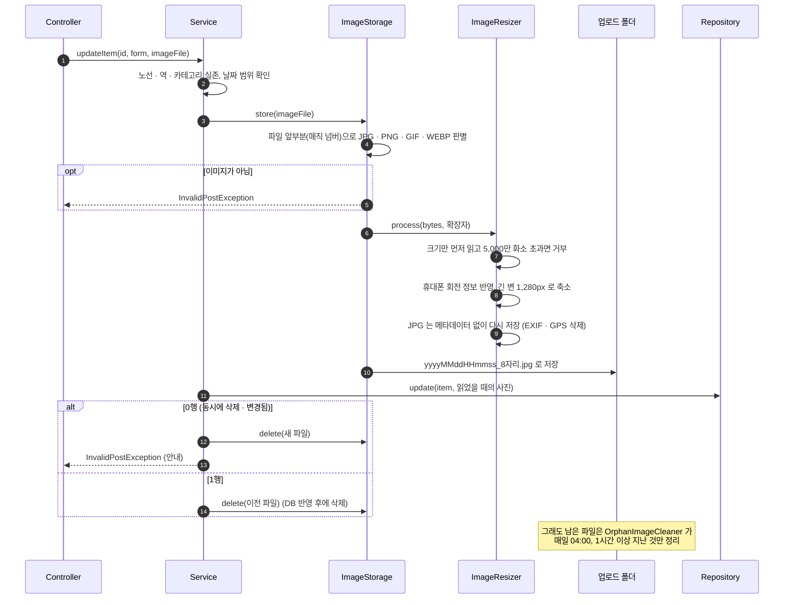

# 시스템 구조·DB 설계

**한국어** | [日本語](ARCHITECTURE.ja.md) · [README](../README.md) · [API 명세](API.md)

## 목차

- [시스템 구조](#시스템-구조)
- [패키지와 역할](#패키지와-역할)
- [DB 설계 (ERD)](#db-설계-erd)
- [주요 요청 흐름](#주요-요청-흐름)
- [설계 판단](#설계-판단)

## 시스템 구조

서버에서 화면을 만들어 돌려주는 Spring MVC 애플리케이션입니다 (Spring Boot 4 · Java 21 · 내장 Tomcat). DB 는 파일로 저장하는 H2, DB 접근은 JdbcTemplate 으로 SQL 을 직접 씁니다.

- 화면의 스크립트는 모두 파일로 불러오고(`script-src 'self'`), 외부에서 받는 것은 지도 타일 이미지뿐입니다. flatpickr·Leaflet 은 WebJars 로 프로젝트에 포함했습니다.
- CSS·JS·로고 주소에는 파일 내용의 해시를 붙여(`mobile-<해시>.css`) 1년 동안 캐시하고, 파일을 고치면 주소가 바뀝니다.
- 실행 환경 설정: DB 주소 `SPRING_DATASOURCE_URL`, 업로드 폴더 `JRFIND_UPLOAD_DIR`, H2 콘솔 `JRFIND_H2_CONSOLE` (기본 꺼짐).

## 패키지와 역할

`com.example.jrfind`

| 패키지 | 클래스 | 역할 |
|---|---|---|
| `config` | `SecurityConfig` | 회원 전용 경로, 폼 로그인, 로그아웃, 세션 목록(SessionRegistry), CSP 등 보안 헤더 |
| | `LoginAttemptGuard` | `POST /login` 앞의 필터 + 성공·실패 처리: 잠금 확인, 실패 횟수 기록, 돌아갈 화면(`next`) |
| | `ExpiredFormHandler` | CSRF 토큰 불일치를 403 대신 보던 화면 + `?expired` 로, 입력은 `FormDraft` 로 보관 |
| | `WebMvcConfig` | `/images/**`(업로드 폴더), `/logo/**`(해시 주소) 경로와 캐시 |
| | `CacheConfig` | 노선·역·카테고리·역 위치를 메모리에 두는 캐시 (`@EnableCaching`) |
| `controller` | `JrfindController` · `LostItemController` | 두 게시판의 목록·상세·등록·수정·삭제, 비회원 글 비밀번호 확인 |
| | `CommentController` | 댓글 등록·삭제 (두 게시판 공통) |
| | `SearchController` · `MapController` · `MemberController` · `MyPageController` · `CsrfController` | 통합 검색, 駅マップ, 가입·로그인 화면, 마이페이지, CSRF 토큰 |
| | `VerifiedItems` · `SubmittedForms` (세션 범위), `FormDraft` | 비밀번호 확인을 통과한 글, 10분 안 같은 내용 재전송 막기, 보내지 못한 입력 보관 |
| | `BoardQuery` · `LoginMemberAdvice` · `FormErrors` · `SearchKeyword` | 조건을 유지한 목록 링크·페이지 번호, 화면 공통 로그인 정보, 오류 문구, 검색어 정리 |
| `domain` | `FoundItem` · `LostItem` · `Comment` · `Member` 등, `*Form` | 데이터와 입력 폼(Bean Validation), `Texts`(입력 문자열 정리), `Board`(게시판 종류) |
| `service` | `JrfindService` · `LostItemService` · `CommentService` · `MemberService` · `MapService` | 업무 처리: 마스터 데이터 확인, 제목 생성, 동시 변경 처리, 닉네임 변경·탈퇴(트랜잭션) |
| | `PasswordAttemptLimiter` | 비회원 글 비밀번호·로그인·현재 비밀번호의 연속 실패 잠금 (5분) |
| | `ImageStorage` · `ImageResizer` · `OrphanImageCleaner` | 사진 형식 확인·축소·저장·삭제, 쓰이지 않는 사진 정리 |
| `repository` | `Jdbc*Repository` (인터페이스 + JdbcTemplate 구현) | SQL. 조건부 UPDATE·DELETE, `INSERT … SELECT`, 목록 필터·정렬·페이지 |
| | `KeywordCondition` · `SearchTextBackfill` | 검색 조건과 검색용 값(NFKC·소문자), 비어 있는 검색용 컬럼 채우기 |

## DB 설계 (ERD)

테이블 7개 (`src/main/resources/schema.sql`). 실선은 외래 키, 점선은 외래 키 없이 애플리케이션에서 확인하는 관계입니다.

### 제약 조건

| 테이블 | 제약 | 내용 |
|---|---|---|
| `MEMBER` | `CK_MEMBER_WITHDRAWN` (CHECK) | 탈퇴하지 않은 회원은 ID·비밀번호·氏名·生年月日·電話番号가 모두 있고, 탈퇴한 회원(`WITHDRAWNDATE` 있음)은 모두 NULL |
| `MEMBER` | `LOGINKEY` 생성 컬럼 + `UK_MEMBER_LOGINKEY` | `LOWER(LOGINID)` 에 유일 인덱스 → `Taro` 와 `taro` 가 동시에 가입해도 DB 에서 막음. 탈퇴 회원은 NULL 이라 여러 명 가능 |
| `MEMBER` | `LOGINID` UNIQUE | 탈퇴하면 NULL (같은 ID 로 다시 가입 가능) |
| `POST_COMMENT` | CHECK `(FOUNDITEMID IS NULL) <> (LOSTITEMID IS NULL)` | 댓글은 두 게시판 중 정확히 한 글에만 연결 |
| `CATEGORY` | `CATEGORYNAME` UNIQUE | |
| `STATION` | UNIQUE `(LINENAME, STATIONNAME)` | 같은 역이 여러 노선에 있으면 노선마다 한 행 |

### 인덱스

| 이름 | 대상 | 용도 |
|---|---|---|
| `IX_FOUND_ITEM_REGDATE` | `FOUND_ITEM(REGISTRATIONDATE, ID)` | 작성일 순 목록 (기본 정렬) |
| `IX_FOUND_ITEM_FOUNDDATE` | `FOUND_ITEM(FOUNDDATE, ID)` | 발견일 순 목록 |
| `IX_LOST_ITEM_REGDATE` | `LOST_ITEM(REGISTRATIONDATE, ID)` | 작성일 순 목록 |
| `IX_LOST_ITEM_LOSTDATE` | `LOST_ITEM(LOSTDATE, ID)` | 분실일 순 목록 |
| `UK_MEMBER_LOGINKEY` | `MEMBER(LOGINKEY)` | 대소문자를 구분하지 않는 ID 유일성 |

- 외래 키 컬럼(`MEMBERID`, `FOUNDITEMID`, `LOSTITEMID`)에는 H2 가 인덱스를 자동으로 만듭니다 (목록의 댓글 수, 마이페이지).
- 마스터 데이터(`data.sql`, 기동할 때마다 `MERGE`): 카테고리 11, 노선·역 78행(6개 노선), 역 위치 47.
- 스키마는 기동할 때마다 `CREATE … IF NOT EXISTS` / `ALTER … IF NOT EXISTS` 로 반영되므로, 예전 DB 도 그대로 새 구조로 올라갑니다.

## 주요 요청 흐름

### 1. 비회원 글 수정 (4자리 비밀번호 확인 → 세션에 기록 → 조건부 UPDATE)

### 2. 회원 로그인 (연속 실패 제한)

### 3. 사진을 바꾼 수정 (형식 확인 → 축소·EXIF 삭제 → 저장 → 조건부 UPDATE → 이전 파일 삭제)

## 설계 판단

| 주제 | 선택 | 이유 |
|---|---|---|
| DB 접근 | JdbcTemplate (JPA 를 쓰지 않음) | 실습에서 익힌 방식이고 테이블이 7개로 작습니다. 조건부 UPDATE, `INSERT … SELECT`, LIKE 이스케이프처럼 실행되는 SQL 을 그대로 보고 제어해야 하는 곳이 많습니다. |
| 동시 수정·삭제 | 조건부 UPDATE·DELETE | `WHERE DEL_FLG = FALSE AND ImgPath IS NOT DISTINCT FROM ?` 로 "읽었을 때와 그대로인 경우만" 반영합니다. 늦은 쪽은 안내하고 새로 저장한 사진은 지워, 지운 글에 사진이 공개된 채 남거나 쓰이지 않는 파일이 쌓이지 않게 했습니다. 삭제는 사진이 바뀌면 다시 읽어 최대 5번 시도합니다. |
| 댓글 저장 | `INSERT … SELECT … WHERE DEL_FLG = FALSE` | 글이 있는지 확인과 저장을 한 문장으로 해서, 확인 직후 글이 삭제돼도 댓글이 들어가지 않습니다. |
| 검색 | 검색용 컬럼 `SEARCHTEXT` | 저장할 때 제목+본문을 NFKC·소문자로 맞춰 두고, 검색어도 같은 방법으로 맞춰 한 컬럼만 비교합니다. 예전에는 검색할 때마다 모든 글을 `LOWER(TRANSLATE(…))` 로 변환해 글 1만 건에서 가장 느린 검색이 약 2.9초였고, 지금은 수십 ms 입니다 ([README 성능](../README.md#성능)). |
| 목록 정렬 | `(작성일·발견일·분실일, ID)` 인덱스 | 인덱스 순서대로 앞에서 한 페이지만 읽습니다. 없으면 모든 글의 댓글 수를 센 뒤 정렬해야 했습니다. 같은 날짜의 글이 페이지마다 섞이지 않도록 ID 를 함께 씁니다. |
| 마스터 데이터 | `@Cacheable` (메모리) | 노선·역·카테고리·역 위치는 기동할 때 `data.sql` 로만 바뀌므로 처음 한 번만 읽습니다. 바꿀 수 없는 List 로 돌려줍니다. |
| 세션 | 로그인하지 않고 보기만 하면 만들지 않음 | CSRF 토큰을 만들면 세션이 생기므로 열람 화면에는 넣지 않고, JS 가 보낼 때 `GET /csrf` 로 받습니다. 방문자·검색 로봇마다 서버 메모리에 세션이 쌓이지 않습니다. |
| 비회원 글 권한 | 세션 범위 `VerifiedItems` | 비밀번호 확인 결과를 화면(JS)이 아니라 서버 세션에 기록하고, 수정·삭제 요청마다 서버가 확인합니다. 수정이 끝나면 지워 다시 확인하게 합니다. |
| 사진 | 형식 확인 + 축소 + EXIF 삭제 | 확장자·Content-Type 은 바꿀 수 있으므로 파일 앞부분으로 판별합니다. 휴대폰 사진의 촬영 위치(GPS)가 공개되지 않도록 JPG 는 항상 다시 저장합니다. |
| 화면 스크립트 | 모두 파일, CSP `script-src 'self'` | 인라인 스크립트·`on…` 속성을 없애 게시글에 스크립트가 끼어들어도 실행되지 않게 했습니다. 외부 라이브러리는 WebJars 로 포함했습니다. |
